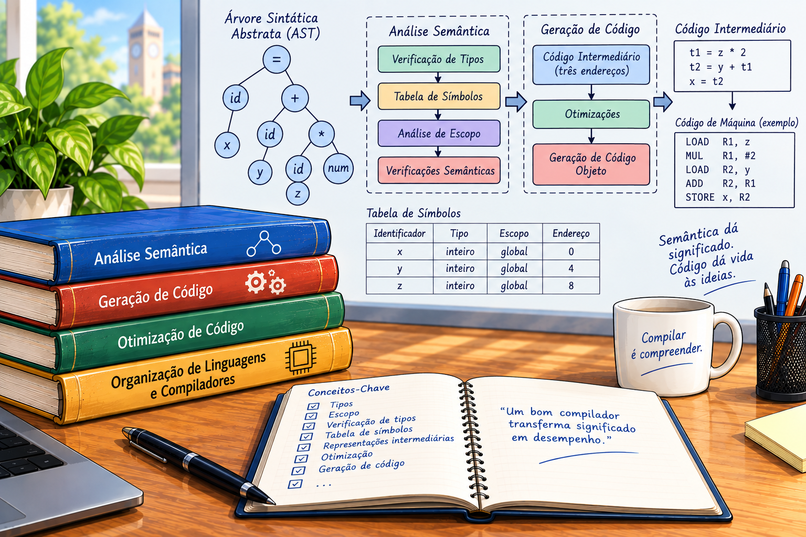
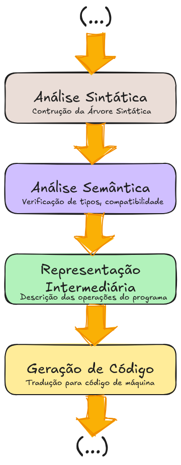
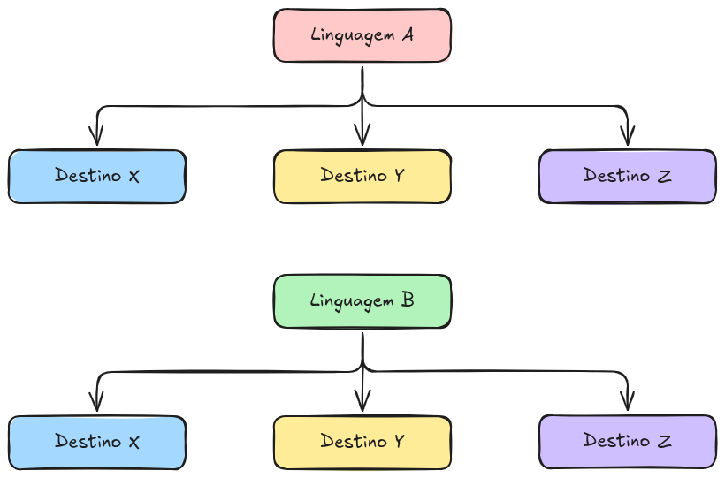
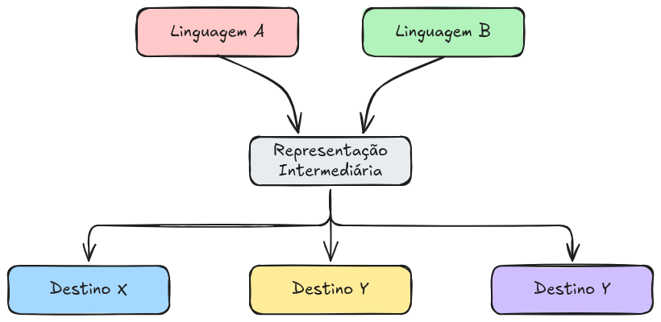
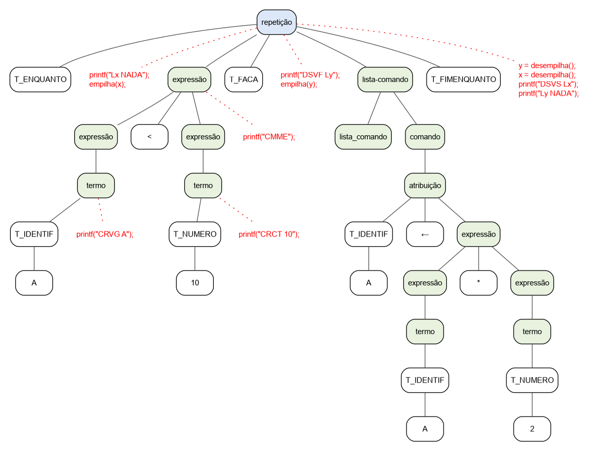
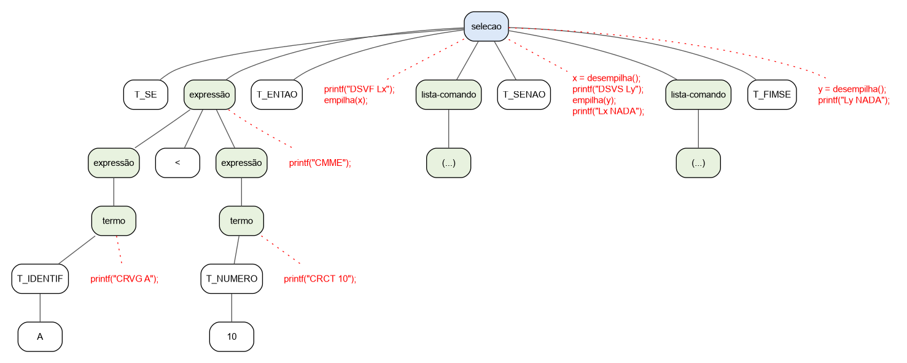

# A Análise Semântica e a Geração de Código

{fig-align="center" width=70%}


A análise semântica e a geração de código são etapas fundamentais do processo de compilação. Enquanto a análise léxica identifica os elementos que compõem o programa e a análise sintática verifica se esses elementos estão organizados de acordo com a gramática da linguagem, a análise semântica verifica se o programa possui significado válido segundo as regras da linguagem. Em seguida, a geração de código transforma a estrutura analisada em uma representação adequada para execução ou para uma etapa posterior do processo de compilação.

Essas etapas estabelecem a ligação entre a estrutura formal de um programa e seu comportamento durante a execução. Para compreender essa relação, é necessário considerar não apenas a organização dos comandos, mas também o significado das variáveis, os tipos dos dados, as declarações e as operações realizadas.

Neste capítulo, estudaremos como o compilador utiliza as informações produzidas pelas etapas anteriores para verificar a consistência do programa e transformá-lo em código. Também veremos por que uma representação intermediária facilita a separação entre as características da linguagem de origem e as particularidades da máquina ou do ambiente de execução de destino.

## Da análise sintática à análise semântica

A análise sintática determina se um programa pode ser reconhecido pela gramática da linguagem. Seu resultado é, geralmente, uma árvore sintática ou uma árvore sintática abstrata (Abstract Syntax Tree — AST), que representa a organização hierárquica dos elementos do programa. Entretanto, reconhecer uma estrutura sintática válida não é suficiente para garantir que o programa esteja correto.

Considere o seguinte trecho de uma linguagem de programação hipotética:

```{.simples}
inteiro idade
idade <- 20
```

Supondo que a linguagem permita a declaração de variáveis inteiras e comandos de atribuição, esse programa apresenta uma estrutura sintática válida. A declaração introduz a variável `idade`, e a atribuição associa a ela o valor `20`.

Agora, considere o seguinte trecho:

```{.simples}
idade <- 20
```

Esse segundo trecho também pode ser sintaticamente válido. Entretanto, se a linguagem exigir que uma variável seja declarada antes de sua utilização e não existir nenhuma declaração anterior de `idade`, o programa apresenta um erro semântico.

A diferença entre os dois casos evidencia que a análise sintática e a análise semântica verificam propriedades distintas. A primeira examina a organização dos símbolos de acordo com as regras gramaticais; a segunda verifica se essa organização faz algum sentido dentro do contexto do programa usando a linguagem de programação.

Em um compilador, essa etapa normalmente depende de informações que não podem ser verificadas apenas pela gramática, como as declarações existentes, os tipos das expressões e as regras de visibilidade dos identificadores. Para realizar essas verificações, o compilador mantém estruturas auxiliares, como a tabela de símbolos e a pilha semântica, e percorre a árvore sintática para examinar as construções do programa.

A análise semântica não substitui a análise sintática. Ao contrário, ela utiliza seus resultados para realizar verificações de natureza diferente. Em geral, um compilador só inicia a análise semântica sobre uma unidade sintática quando dispõe de uma estrutura suficientemente válida para examiná-la.

### O papel da análise semântica

A análise semântica verifica se as construções sintaticamente válidas obedecem às regras que definem seu significado na linguagem de programação. Seu objetivo é identificar inconsistências que poderiam comprometer a tradução ou a execução do programa.

As verificações realizadas dependem das características da linguagem. Entre as mais comuns, destacam-se:

- Declaração de identificadores: verificar se variáveis, funções e outros identificadores utilizados no programa foram declarados conforme as regras da linguagem.
- Escopo e visibilidade: determinar em quais regiões do programa cada identificador pode ser utilizado.
- Verificação de tipos: conferir se os tipos dos operandos são compatíveis com as operações realizadas.
- Compatibilidade de atribuição: verificar se o valor de uma expressão pode ser atribuído à variável de destino.
- Uso correto de operações e chamadas: conferir a quantidade e os tipos dos argumentos de uma função, quando aplicável, bem como as restrições impostas aos operadores.
- Consistência das estruturas de controle: verificar condições e outras restrições semânticas associadas a comandos condicionais, laços e retornos de funções.

Considere o exemplo:

```{.simples}
inteiro x
logico y

x <- 10
y <- V
y <- x + y
```

Nesse programa, a análise semântica identifica que `x` possui tipo inteiro e `y` possui tipo lógico. A expressão `x + y` combina um operando inteiro com um operando lógico. Se a linguagem permitir essa operação, o compilador deverá determinar como os tipos são tratados, por exemplo, por meio da conversão do valor lógico para inteiro. A atribuição do resultado a `y` será então verificada de acordo com as regras de compatibilidade da linguagem.

Essas regras não são universais. Algumas linguagens permitem conversões implícitas entre determinados tipos, enquanto outras exigem conversões explícitas. Da mesma forma, certas linguagens são mais permissivas quanto à utilização de valores em expressões, enquanto outras impõem verificações mais rigorosas.

A análise semântica também pode exigir informações sobre declarações que aparecem em outras partes do programa. Por exemplo, ao encontrar uma chamada de função, o compilador pode precisar consultar a tabela de símbolos para verificar sua existência, seus parâmetros e seu tipo de retorno.

A tabela de símbolos é uma estrutura de dados utilizada para armazenar informações sobre os identificadores do programa. Dependendo da linguagem e da implementação do compilador, ela pode registrar o nome de cada identificador, seu tipo, sua categoria, seu escopo, seus parâmetros e outras propriedades relevantes. Essas informações são consultadas durante a análise semântica e podem ser reutilizadas na geração de código.

Ao final dessa etapa, o compilador dispõe de uma estrutura sintática enriquecida com informações semânticas. Isso permite que a geração de código utilize os tipos, as declarações e as características das operações para produzir uma representação coerente com o significado do programa original.

É importante observar que a análise semântica não garante a ausência de todos os erros possíveis. Ela verifica as propriedades que podem ser determinadas pelas regras da linguagem e pelas informações disponíveis durante a compilação. Erros relacionados a valores de entrada, condições de execução ou outros comportamentos dependentes do ambiente podem continuar ocorrendo durante a execução.

### Da estrutura sintática à execução

Depois de analisar sintaticamente e semanticamente um programa, o compilador precisa transformá-lo em uma forma que possa ser executada por um processador ou por um ambiente de execução. Essa transformação é conhecida como geração de código e pode envolver várias etapas intermediárias.

Para compreender esse processo, considere o seguinte programa hipotético:

```{.simples}
inteiro a b resultado

a <- 10
b <- 20
resultado <- a + b
```

A análise sintática identifica as declarações, as atribuições e a expressão aritmética, organizando esses elementos em uma árvore sintática abstrata. A análise semântica verifica se as variáveis foram declaradas, se seus tipos são compatíveis e se a operação de adição é válida.

Essas etapas permitem compreender o significado do programa, mas ainda não definem diretamente como suas operações serão realizadas por uma máquina. É necessário traduzir as construções da linguagem de origem para instruções que representem as operações correspondentes.

Uma possível representação intermediária na forma de triplas do trecho do programa poderia ser:

| Índice | Operador (`op`) | Argumento 1 (`arg1`) | Argumento 2 (`arg2`) |
| :--- | :--- | :--- | :--- |
| **(0)** | `<-` | `10` | `a` |
| **(1)** | `<-` | `20` | `b` |
| **(2)** | `+` | `a` | `b` |
| **(3)** | `<-` | `(2)` | `resultado` |

Nessa representação, a expressão aritmética é calculada e seu resultado é armazenado em uma variável temporária, identificada por **(2)**. O valor calculado é posteriormente atribuído à variável `resultado`.

A representação intermediária não precisa reproduzir exatamente a sintaxe da linguagem original. Seu propósito é expressar as operações do programa de maneira mais simples e adequada às transformações realizadas pelo compilador.

A partir dessa representação, pode-se gerar código para diferentes destinos. Em uma máquina virtual didática, por exemplo, as operações poderiam ser traduzidas para instruções de carregamento de valores, realização de operações aritméticas e armazenamento de resultados. Em um processador real, o compilador poderia gerar instruções de máquina, incluindo operações sobre registradores e posições de memória.

O processo pode ser sintetizado da seguinte maneira:

{#fig-semantico width="30%"}

A @fig-semantico apresenta uma visão simplificada do fluxo de compilação. Implementações reais podem incluir etapas adicionais, como otimização, análise de fluxo de dados, alocação de registradores e geração de código específico para a arquitetura de destino.

Também é importante distinguir a geração de código da execução. Em um processo de compilação tradicional, o compilador produz um programa executável ou um código intermediário que será executado posteriormente. Em outras implementações, o código pode ser interpretado ou compilado durante a própria execução. Essas diferenças dependem da arquitetura da linguagem e do ambiente de execução.

### A necessidade de uma representação intermediária

Uma questão importante no desenvolvimento de compiladores é como separar as características da linguagem de origem das particularidades da plataforma de destino. Uma tradução direta entre cada linguagem de programação e cada arquitetura pode exigir a implementação de muitos tradutores diferentes.

Suponha que um compilador precise traduzir programas escritos em duas linguagens de origem para três arquiteturas de destino. Se cada linguagem for traduzida diretamente para cada arquitetura, serão necessárias, potencialmente, seis combinações de tradutores,
conforme ilustrado na @fig-representacao1.

{#fig-representacao1 width="80%"}

Com uma representação intermediária comum, cada linguagem pode ser traduzida para essa representação, e cada arquitetura pode receber um gerador específico capaz de convertê-la em seu próprio código. Nesse cenário simplificado, seriam necessários dois tradutores para a representação intermediária e três geradores de código, totalizando cinco componentes de tradução.

Com representação intermediária, os tradutores e os geradores podem ser desenvolvidos de forma independente, conforme ilustrado na @fig-representacao2.

{#fig-representacao2 width="80%"}

O número de combinações cresce com a quantidade de linguagens e destinos. Por exemplo, 3 linguagens e 5 destinos totalizam 15 componentes de tradução sem representação intermediária e 8 componentes com representação intermediária.

Essa separação facilita a manutenção e a expansão de um compilador. Para adicionar uma nova linguagem de origem, pode-se implementar um tradutor para a representação intermediária existente. Para oferecer suporte a uma nova arquitetura, pode-se implementar um gerador de código correspondente, desde que ele seja compatível com essa representação.

Além disso, a representação intermediária favorece a otimização. Como ela expressa as operações do programa de maneira independente de muitos detalhes da linguagem original, o compilador pode identificar oportunidades para simplificar expressões, eliminar cálculos desnecessários e melhorar a utilização dos recursos disponíveis.

Existem diferentes formas de representação intermediária. Entre elas, destacam-se:

- Árvore sintática abstrata: representa a estrutura essencial do programa, omitindo detalhes sintáticos desnecessários para as etapas posteriores.
- Código de três endereços: representa operações simples, geralmente com um resultado e até dois operandos, utilizando variáveis temporárias quando necessário.
- Código para uma máquina virtual: utiliza instruções de uma máquina abstrata, que podem ser executadas por um interpretador ou traduzidas posteriormente para instruções de uma arquitetura real.

Essas representações não são necessariamente alternativas excludentes. Um compilador pode utilizar uma árvore sintática abstrata, convertê-la em código de três endereços, aplicar otimizações e, posteriormente, produzir instruções para uma máquina virtual ou para um processador específico.

Neste livro, utilizaremos uma abordagem gradual para estudar essas transformações. A análise semântica permitirá compreender como o compilador valida as construções de um programa, que pode ser feito através de uma representação da árvore sintátia, por exemplo. Em seguida, a geração de código para a Máquina Virtual Simples (MVS) permitirá relacionar cada operação do programa às instruções executadas pela máquina abstrata.

Dessa forma, será possível acompanhar o percurso completo de um programa: da estrutura sintática construída pelo analisador até o código gerado e seu comportamento durante a execução. Essa perspectiva integra os conceitos teóricos de compilação à observação prática dos algoritmos e das estruturas utilizadas em sua implementação.

## Tradução dirigida por sintaxe

A tradução dirigida por sintaxe é uma técnica utilizada na construção de compiladores na qual a tradução de um programa é associada às regras gramaticais empregadas para reconhecê-lo. A ideia central consiste em aproveitar a estrutura sintática identificada pelo analisador para calcular informações semânticas ou produzir código correspondente às construções reconhecidas.

Durante a análise sintática, o compilador identifica as produções utilizadas para reconhecer o programa. Na tradução dirigida por sintaxe, cada produção pode ser complementada por regras semânticas ou ações que determinam o que deve ser realizado quando essa produção é aplicada.

Essas ações podem ter diferentes objetivos. Podem calcular o valor de uma expressão, verificar a compatibilidade entre tipos, registrar informações na tabela de símbolos ou produzir instruções para uma máquina virtual. Assim, a tradução deixa de ser uma atividade completamente separada do reconhecimento sintático e passa a utilizar diretamente a estrutura gramatical do programa.

Considere a seguinte produção de uma gramática para expressões aritméticas:

$$ E \rightarrow E_1 + T $$

Nessa produção, \\(E\\) representa a expressão reconhecida, enquanto \\(E_1\\) e \\(T\\) representam seus componentes. Os índices são utilizados apenas para distinguir ocorrências do mesmo símbolo gramatical.

Podemos associar à produção uma regra semântica que constrói a representação pós-fixada da expressão:

$$ E.code = E_1.code \mathbin{\\|} T.code \mathbin{\\|} \text{"+"} $$

O operador `|` representa a concatenação de cadeias de caracteres. A regra estabelece que a representação da expressão resultante é formada pela concatenação do código de $E_1$, do código de $T$ e do operador de adição.

Por exemplo, para a expressão:

```{.simples}
3 + 4
```

a tradução pós-fixada produz:

```{.c}
3 4 +
```

Essa representação coloca o operador depois dos operandos. Sua avaliação pode ser realizada por uma máquina baseada em pilha: os valores `3` e `4` são empilhados e, quando o operador `+` é encontrado, os dois valores são removidos da pilha, somados e substituídos pelo resultado.

O exemplo ilustra como uma regra gramatical pode determinar a construção de uma representação alternativa da expressão. A mesma ideia pode ser utilizada para produzir código de três endereços, instruções de uma máquina virtual ou outras formas de representação intermediária.

### Definições dirigidas por sintaxe e esquemas de tradução

Existem duas formas relacionadas de especificar a tradução associada a uma gramática: as definições dirigidas por sintaxe e os esquemas de tradução.

Uma definição dirigida por sintaxe (DDS) associa atributos aos símbolos da gramática e estabelece regras semânticas para calcular seus valores. Essa abordagem descreve o que deve ser calculado a partir da estrutura sintática, sem exigir que a especificação esteja vinculada a uma implementação particular.

Um esquema de tradução dirigida por sintaxe associa ações executáveis às produções gramaticais. Essas ações podem ser executadas pelo analisador durante o reconhecimento do programa e permitem implementar diretamente os cálculos semânticos ou a emissão de instruções.

Considere novamente a produção:

$$ E \rightarrow E_1 + T $$

Uma definição dirigida por sintaxe pode especificar a construção do código pós-fixado por meio da regra:

$$ E.code = E_1.code \mathbin{\\|} T.code \mathbin{\\|} \text{"+"} $$

Já um esquema de tradução pode executar uma ação que imprime o operador quando a produção é reconhecida, desde que os códigos dos operandos já tenham sido produzidos na ordem apropriada.

Por exemplo, em uma gramática adequada à análise ascendente, a ação pode ser escrita conceitualmente como:

```
E : E1 '+' T
    { printf("+"); }
```

Nesse exemplo, a ação imprime o operador. Para obter a tradução completa, as produções correspondentes aos operandos também precisam produzir suas representações. A posição da ação em relação aos símbolos da produção determina quando ela será executada.

A distinção é importante: a definição dirigida por sintaxe descreve as relações entre atributos, enquanto o esquema de tradução especifica ações que podem ser executadas durante a análise. Na prática, as duas abordagens podem ser utilizadas em conjunto, conforme os requisitos do compilador.

## Atributos sintetizados e herdados

Para formalizar a tradução dirigida por sintaxe, associamos atributos aos símbolos da gramática. Um atributo representa uma informação relacionada a uma ocorrência de um símbolo durante a análise do programa.

Se $X$ é um símbolo gramatical e $a$ é um de seus atributos, representamos esse atributo por $X.a$. Por exemplo, $E.val$ pode representar o valor de uma expressão, enquanto $E.code$ pode armazenar sua representação em código.

Os atributos são classificados em duas categorias principais: sintetizados e herdados.

Atributos sintetizados. Seu valor é calculado a partir dos atributos dos símbolos que aparecem abaixo do nó correspondente na árvore sintática, isto é, de seus filhos. As informações fluem, portanto, das partes componentes para a construção que as reúne.

Considere a produção:

$$ E \rightarrow E_1 + T $$

Podemos definir:

$$ E.val = E_1.val + T.val $$

O valor da expressão $E$ é calculado a partir dos valores de seus componentes. Esse é um atributo sintetizado.

Atributos herdados. Seu valor é determinado a partir de informações associadas ao contexto em que o símbolo aparece, como atributos de seu pai ou de seus irmãos na árvore sintática. As informações podem fluir de um contexto mais amplo para uma parte específica da construção.

Por exemplo, em uma declaração de variáveis, o tipo declarado pode ser propagado para uma lista de identificadores. O atributo que representa esse tipo pode ser herdado pelos símbolos que representam cada identificador, permitindo que o compilador registre corretamente suas informações na tabela de símbolos.

A distinção pode ser resumida da seguinte forma:

| Característica       | Sintetizado                                    | Herdado                                 |
| -------------------- | ---------------------------------------------- | --------------------------------------- |
| Origem da informação | Principalmente os filhos                       | Contexto, pai ou irmãos                 |
| Direção conceitual   | De baixo para cima                             | Do contexto para o símbolo              |
| Exemplo              | Valor de uma expressão                         | Tipo associado a uma lista de variáveis |
| Uso frequente        | Avaliação de expressões e construção de código | Propagação de tipos, escopo e contexto  |

Uma definição dirigida por sintaxe pode utilizar atributos sintetizados, herdados ou ambos. A escolha depende da informação que precisa ser calculada e da forma como ela está disponível durante a análise.

## Definição dirigida por sintaxe para uma calculadora

Considere uma gramática simplificada para avaliar expressões aritméticas, formada por números inteiros, adição e multiplicação:

$$
\begin{aligned} 
L &\rightarrow E\ \backslash n\\
E &\rightarrow E_1 + E_2\\
E &\rightarrow E_1 * E_2\\ 
E &\rightarrow \textit{num} 
\end{aligned} 
$$

O símbolo $L$ representa uma linha de entrada, $E$ representa uma expressão e $\textit{num}$ representa um número reconhecido pelo analisador léxico. O atributo $\textit{num.lexval}$ corresponde ao valor numérico associado ao token.

Podemos definir um atributo sintetizado \\(val\\) para os símbolos \\(L\\) e \\(E\\), conforme as seguintes regras semânticas.

| Produção                                     | Regra semântica               |
| -------------------------------------------- | ----------------------------- |
| $L \rightarrow E\ \backslash n$              | $L.val = E.val$               |
| $E \rightarrow E_1 + E_2$                    | $E.val = E_1.val + E_2.val$   |
| $E \rightarrow E_1 * E_2$                    | $E.val = E_1.val * E_2.val$   |
| $E \rightarrow \textit{num}$                 | $E.val = \textit{num.lexval}$ |

A primeira regra transfere o valor da expressão para a linha reconhecida. A segunda e a terceira calculam os resultados das operações aritméticas. A última associa à expressão o valor do número reconhecido pelo analisador léxico.

Considere a expressão:

```
3 + 4 * 5
```

Supondo que a gramática atribua precedência maior à multiplicação do que à adição, a árvore sintática terá a multiplicação como subexpressão da adição. Os atributos sintetizados serão calculados das folhas em direção à raiz:

$E.val = 23$

3 + 20

3

Valor: 3

\+

Adição

$E.val = 20$

4 × 5

A multiplicação é avaliada antes da adição, e o resultado é sintetizado até a raiz.

O resultado da multiplicação é $4 \times 5 = 20$. Em seguida, a adição calcula $3 + 20 = 23$. O atributo da raiz contém o valor final da expressão.

Esse exemplo mostra que a definição dirigida por sintaxe permite descrever a avaliação de expressões diretamente a partir da estrutura gramatical. A mesma técnica pode ser empregada para construir código, verificar tipos ou calcular outras propriedades necessárias à compilação.

## Esquemas de tradução dirigida por sintaxe

Em um esquema de tradução, as ações semânticas são associadas às produções gramaticais e executadas nos pontos determinados por sua posição. Uma ação pode calcular um atributo, consultar a tabela de símbolos ou emitir instruções para a máquina de destino.

Para a calculadora anterior, um esquema de tradução pode ser representado conceitualmente da seguinte maneira:

| Produção                                     | Ação semântica                |
| -------------------------------------------- | ----------------------------- |
| $L \rightarrow E\ \backslash n$              | Imprimir $E.val$              |
| $E \rightarrow E_1 + E_2$                    | $E.val = E_1.val + E_2.val$   |
| $E \rightarrow E_1 * E_2$                    | $E.val = E_1.val * E_2.val$  |
| $E \rightarrow \textit{num}$                 | $E.val = \textit{num.lexval}$ |

Em uma implementação, essas ações podem ser escritas em uma linguagem de programação. No Bison, por exemplo, as ações semânticas são colocadas entre chaves após os símbolos da produção. Os valores associados aos símbolos podem ser acessados por referências como `$1`, `$2` e `$$`, que representam, respectivamente, valores dos componentes da produção e o valor associado ao símbolo do lado esquerdo.

A definição dos tipos desses valores depende da declaração de `YYSTYPE` ou da utilização de declarações tipadas, como `%union` e `%type`. Assim, o analisador sintático pode transportar valores numéricos, endereços de variáveis, tipos ou outras informações necessárias às ações semânticas.

É importante observar que o cálculo do valor de uma expressão e a geração de código são tarefas distintas, embora ambas possam ser implementadas por ações semânticas. Na avaliação, o objetivo é calcular o resultado da expressão. Na geração de código, o objetivo é produzir instruções que, quando executadas, realizem a operação correspondente.

## Geração de código para a Máquina Virtual Simples

A tradução dirigida por sintaxe permite integrar a geração de código ao analisador sintático. Quando uma produção é reconhecida, sua ação semântica pode emitir as instruções necessárias para representar a construção correspondente.

Neste capítulo, utilizaremos a Máquina Virtual Simples (MVS) como destino para exemplificar esse processo. A MVS possui instruções para carregar constantes, acessar variáveis, realizar operações aritméticas e armazenar resultados. Sua arquitetura baseada em pilha permite compreender como as expressões são traduzidas sem exigir, inicialmente, o estudo de registradores de uma arquitetura real.

Considere o seguinte fragmento de gramática, escrito no estilo do Bison:

```{.c}
cmd :
      expr
        { }
    | VAR ATRIBUI expr
        { printf("\tARZG\t%d\n", $1); }
    ;

expr :
      NUM
        { printf("\tCRCT\t%d\n", $1); }
    | VAR
        { printf("\tCRVG\t%d\n", $1); }
    | expr MAIS expr
        { printf("\tSOMA\n"); }
    | expr MENOS expr
        { printf("\tSUBT\n"); }
    | expr BARRA expr
        { printf("\tDIVI\n"); }
    | expr VEZES expr
        { printf("\tMULT\n"); }
    | ABRE expr FECHA
        { }
    ;
```

Nesse fragmento, `cmd` representa um comando, enquanto `expr` representa uma expressão aritmética. Os nomes `NUM`, `VAR`, `ATRIBUI`, `MAIS`, `MENOS`, `BARRA`, `VEZES`, `ABRE` e `FECHA` representam tokens definidos pelo analisador léxico.

As ações semânticas produzem instruções da MVS conforme as construções reconhecidas:

- `CRCT` carrega uma constante na pilha.
- `CRVG` carrega na pilha o valor de uma variável.
- `SOMA` remove os dois operandos do topo da pilha, soma seus valores e empilha o resultado.
- `SUBT`, `MULT` e `DIVI` realizam as operações aritméticas correspondentes.
- `ARZG` armazena o valor do topo da pilha no endereço da variável indicada.

As instruções emitidas para uma expressão devem respeitar a ordem de execução da máquina. Primeiro são carregados os operandos; depois, a instrução correspondente à operação é executada. Dessa forma, a avaliação de uma expressão deixa de depender de uma ação direta sobre os valores durante a compilação e passa a ser representada por instruções que serão executadas posteriormente.

### Exemplo de geração de código

Considere o comando:

```{.simples}
resultado <- 10 + 20
```

Suponha que o analisador léxico associe o endereço `3` à variável `resultado`. Durante a análise sintática, a expressão `10 + 20` é reconhecida, e suas ações semânticas emitem as instruções correspondentes. Ao final, a ação da atribuição armazena o resultado no endereço da variável.

O código gerado será semelhante a:

```{.mvs}
CRCT    10
CRCT    20
SOMA
ARZG    3
```

A execução ocorre na seguinte ordem:

CRCT 10

Carregamento da primeira constante

O valor `10` é colocado no topo da pilha.

CRCT 20

Carregamento da segunda constante

O valor `20` é empilhado sobre o valor anterior.

SOMA

Operação aritmética

Os valores `10` e `20` são removidos da pilha, somados, e o resultado `30` é colocado no topo.

ARZG 3

Armazenamento do resultado

O valor `30` é armazenado no endereço associado à variável `resultado`.

O exemplo demonstra a relação entre a estrutura sintática do comando, as ações semânticas executadas pelo analisador e o código produzido para a MVS. A atribuição é reconhecida como um comando completo, mas as instruções de cálculo da expressão são emitidas antes da instrução de armazenamento.

Na implementação real, o endereço associado ao token `VAR` deve ser obtido de uma tabela de símbolos ou de outra estrutura equivalente. O exemplo pressupõe que `$1` contenha esse endereço e que `$1` em `NUM` contenha o valor numérico do token.

Também é necessário configurar a gramática para respeitar a precedência e a associatividade dos operadores. Sem essas declarações ou uma gramática estruturada em níveis de precedência, expressões como `2 + 3 * 4` podem gerar conflitos ou ser agrupadas de maneira diferente da esperada. Além disso, o tratamento de divisões por zero e outras condições de execução depende das regras adotadas pela MVS.

### Geração de código durante a análise sintática

No exemplo anterior, o código é produzido diretamente pelas ações semânticas do analisador sintático. Essa abordagem é simples e adequada a compiladores didáticos, nos quais se deseja acompanhar a relação entre uma produção gramatical e a instrução correspondente.

Entretanto, a geração direta apresenta limitações quando o compilador precisa realizar otimizações, reorganizar instruções ou produzir código para diferentes arquiteturas. Como as instruções são emitidas à medida que a análise ocorre, pode ser necessário armazená-las, revisá-las ou reconstruir partes do código para realizar transformações mais complexas.

Uma alternativa consiste em construir uma representação intermediária entre a análise semântica e a geração de código. Nesse modelo, as ações semânticas produzem uma representação independente da máquina de destino. Em uma etapa posterior, um gerador traduz essa representação para as instruções da MVS.

Por exemplo, para o comando:

```{.simples}
resultado <- 10 + 20
```

a representação intermediária poderia ser:

```{.c}
t1 = 10 + 20
resultado = t1
```

O gerador de código transforma essas operações em instruções da MVS, considerando a forma de acesso às variáveis e o funcionamento da pilha. Essa separação permite alterar o gerador sem modificar a análise sintática e possibilita aplicar otimizações sobre a representação intermediária.

Portanto, existem duas estratégias complementares: emitir código diretamente durante a análise sintática ou construir uma representação intermediária para gerar o código em uma etapa posterior. A escolha depende da complexidade do compilador e dos objetivos de sua implementação.

Para um compilador simples, a geração direta facilita o entendimento do processo. Para compiladores maiores, uma representação intermediária tende a favorecer a organização, a manutenção e a implementação de otimizações.

Em ambos os casos, a tradução dirigida por sintaxe estabelece uma ligação explícita entre as regras da gramática e as operações necessárias para traduzir o programa. Essa ligação permite compreender como o compilador passa da identificação das construções sintáticas à produção de instruções que preservam o significado do programa de origem.


### Projeto do Compilador - Parte 3


O projeto implementa um compilador para uma linguagem simples, denominada nos arquivos como linguagem `simples`. O programa de entrada contém declarações de variáveis e comandos de atribuição, leitura, escrita, seleção e repetição. O compilador verifica a estrutura sintática do programa, realiza verificações semânticas e produz um arquivo contendo as instruções da MVS.

A implementação está distribuída em dois arquivos principais:

- `sintatico.y`: contém a gramática da linguagem, as ações semânticas associadas às produções e a rotina principal que controla a leitura do programa e a geração do arquivo de saída.
- `utils.c`: contém as estruturas e funções auxiliares utilizadas na análise semântica, incluindo a tabela de símbolos, a pilha de tipos e as operações de verificação de compatibilidade.

O arquivo `sintatico.y` utiliza o Bison para gerar o analisador sintático em C. Os tokens são fornecidos pelo analisador léxico, responsável por reconhecer palavras reservadas, identificadores, números e operadores. A comunicação entre as etapas ocorre por meio dos tokens e das informações associadas a eles, como o conteúdo textual armazenado em `atomo`.

O fluxo geral de compilação pode ser representado da seguinte forma:

Programa-fonte

Arquivo com extensão `.simples`

Analisador léxico

Reconhece tokens e fornece seus valores

Analisador sintático e semântico

Bison, tabela de símbolos, pilha de tipos e ações semânticas

Código para a MVS

Arquivo com extensão `.mvs`

Nesse projeto, não é construída uma representação intermediária completa para depois gerar o código. As ações semânticas escrevem diretamente as instruções da MVS no arquivo de saída. Essa escolha simplifica a implementação e permite observar como cada construção da linguagem de origem se transforma em instruções da máquina virtual.

#### O arquivo `utils.c`: estruturas de apoio à análise semântica

O arquivo `utils.c` reúne os mecanismos necessários para armazenar informações sobre os identificadores, acompanhar os tipos das expressões e detectar algumas inconsistências semânticas.

#### Tabela de símbolos

A tabela de símbolos é implementada por meio de um vetor de estruturas:

```{.c}
/*-----------------------------------
 * Estrutura da Tabela de Símbolos
 *-----------------------------------*/

#define TAMTAB 100
typedef struct
{
    char nome[30];
    int tipo;
    int end;
} tiptab;

tiptab elemtab, tabsimb[TAMTAB];
int topotab = -1;
```

Cada elemento da tabela contém três informações:

- `nome`: nome do identificador;
- `end`: endereço associado à variável na memória da MVS;
- `tipo`: tipo da variável, que pode ser inteiro (`INT`) ou lógico (`LOG`).

A constante `TAMTAB` estabelece a capacidade máxima da tabela, de 100 identificadores. A variável `topotab` indica a quantidade de posições ocupadas e, consequentemente, a próxima posição disponível para inserção.

#### Inserção de identificadores

A função `inseresimbolo` recebe uma estrutura contendo as informações de uma variável e a registra na tabela de símbolos. Antes da inserção, verifica se a tabela está cheia e se o identificador já foi declarado.

A detecção de identificadores duplicados evita que duas declarações utilizem o mesmo nome, conforme as regras adotadas por essa implementação. Caso o nome já esteja registrado, a função chama `yyerror` para informar o problema.

Durante a análise das declarações, o compilador preenche os campos da estrutura `elemTab` e chama essa função para registrar cada variável. O endereço é atribuído sequencialmente por meio da variável `contaVar`, enquanto o tipo é obtido da declaração correspondente.

#### Busca de identificadores

A função `buscasimbolo` procura um identificador pelo nome e retorna sua posição na tabela. Ela é utilizada quando o programa faz referência a uma variável, seja em uma expressão, em uma atribuição ou em um comando de leitura.

Se o identificador não estiver cadastrado, a função comunica o erro por meio de `yyerror`. Caso seja encontrado, o compilador pode consultar seus campos `end` e `tip` para gerar o código apropriado e verificar a compatibilidade de tipos.

A tabela de símbolos desempenha, portanto, duas funções importantes: permite verificar se as variáveis foram declaradas e fornece os endereços e tipos necessários às etapas seguintes da compilação.

#### Pilha Semântica

A verificação dos tipos das expressões, a resolução de rótulos nas estruturas de seleção e repetição e outras situações da compilação são resolvidas com o auxílio de uma pilha da pilha semântica

```{.c}
enum
{
    INT = 10,
    LOG = 20
};

/*-----------------------------------
 * Estrutura da Pilha Semantica
 *-----------------------------------*/
#define TAMPILHA 100
struct
{
    int valor;
    char tipo;
} Pilha[TAMPILHA];

int topo = -1;
```

Os tipos são representados por constantes inteiras definidas no `enum`. O tipo `INT` identifica valores inteiros, enquanto `LOG` identifica valores lógicos. Esses tipos serão utilizados durante a análise semântica para verificar se as operações e atribuições são compatíveis com as regras da linguagem.

As funções `empilha` e `desempilha` inserem e removem valores dessa estrutura, verificando seus limites. No compilador, os valores armazenados representam os tipos das expressões reconhecidas, os rótulos, posição de identificadores na tabela de símbolos e contagem de variáveis na declaração.

A utilização de uma pilha é adequada à análise sintática ascendente realizada pelo Bison para verificação de tipos nas expressões, por exemplo. Quando uma expressão simples é reconhecida, seu tipo é colocado na pilha. Quando uma produção combina duas expressões, seus tipos são removidos, verificados e substituídos pelo tipo resultante.

A função `testaTipo` implementa esse procedimento:

```{.c}
void testatipo(int tipo1, int tipo2, int ret)
{
    int t2 = desempilha('t');
    int t1 = desempilha('t');

    if (t1 != tipo1 || t2 != tipo2)
        yyerror("Incompatibilidade de tipo!");

    empilha(ret, 't');
}
```

Os parâmetros `tipo1` e `tipo2` indicam os tipos esperados para os operandos, e `ret` representa o tipo do resultado da operação. Se os tipos encontrados não forem os esperados, o compilador comunica uma incompatibilidade. Caso contrário, o tipo resultante é colocado na pilha para ser utilizado pelas produções superiores.

Por exemplo, a soma exige dois operandos inteiros e produz um resultado inteiro. Já uma comparação entre inteiros produz um valor lógico. Essa diferença permite que o compilador verifique não apenas os operandos, mas também o tipo produzido por cada operação.

### O arquivo `sintatico.y`: análise sintática, semântica e geração de código

O arquivo `sintatico.y` contém a especificação da gramática e as ações semânticas que serão executadas durante o reconhecimento do programa. Além de identificar as construções válidas da linguagem, essas ações consultam a tabela de símbolos, verificam os tipos das expressões e emitem instruções da MVS.

#### Declarações e variáveis globais

No início do arquivo, são incluídas bibliotecas da linguagem C e o arquivo `utils.c`. Também são declaradas funções e variáveis externas utilizadas pelo analisador léxico e pelo sistema de entrada e saída.

Entre as variáveis globais, destacam-se:

```{.c}
extern int nlinha;   // numero da linha
int contavar = 0;    // contador de variveis
int rotulo = 0;      // contador de rotulos
int tipo;            // tipo da variavel
```

A variável `nlinha` é atualizada toda vez que o analisador léxico passa pelo caracter `\\n`. A variável `contavar` controla a quantidade de variáveis declaradas e permite atribuir endereços sequenciais às posições de memória utilizadas pelo programa. A variável `tipo` armazena temporariamente o tipo da declaração em processamento. Já `rotulo` controla a numeração dos rótulos utilizados nos comandos de seleção e repetição.

Os rótulos são necessários porque as estruturas de controle geram desvios no fluxo de execução. Uma instrução condicional pode transferir o controle para uma posição posterior do código, enquanto um laço precisa retornar a uma posição anterior para avaliar novamente sua condição.

#### Tokens e precedência dos operadores

As diretivas `%token` declaram os símbolos terminais reconhecidos pelo analisador léxico. Entre eles estão os tokens que representam as palavras reservadas da linguagem, como `T_PROGRAMA`, `T_INICIO`, `T_FIM`, `T_LEIA`, `T_ESCREVA`, `T_ENQTO` e `T_SE`.

Também são declarados tokens para identificadores, números, tipos, operadores aritméticos, operadores relacionais e operadores lógicos.

As declarações de precedência estabelecem a prioridade relativa dos operadores:

```{.c}
%left T_E T_OU
%left T_IGUAL
%left T_MAIOR T_MENOR
%left T_MAIS T_MENOS
%left T_VEZES T_DIV
```

A diretiva `%left` indica associatividade à esquerda. No Bison, as declarações posteriores possuem maior precedência que as anteriores. Assim, a ordem apresentada estabelece a multiplicação e a divisão como operadores de maior precedência entre os declarados, seguidas pela adição e subtração, pelos operadores relacionais e pela igualdade, ficando os operadores lógicos `E` e `OU` no nível mais baixo.

Essa organização permite interpretar expressões como:

```{.simples}
3 + 4 * 5
```

de modo que a multiplicação seja realizada antes da adição. A precedência definida pelo analisador é essencial para que a estrutura sintática e o código gerado correspondam à interpretação esperada da expressão.

#### Estrutura geral do programa

A produção inicial é declarada pela diretiva:

```{.c}
%start programa
```

Isso estabelece `programa` como o símbolo inicial da gramática. A produção correspondente define a organização geral de um programa-fonte:

```{.c}
programa
    : cabecalho 
         { fprintf(yyout, "\tINPP\n"); }
      variaveis 
         { 
            DEBUG(mostratabela();)
            empilha(contavar, 'c');
            if (contavar > 0) {
               fprintf(yyout, "\tAMEM\t%d\n", contavar);
            } 
         }
      T_INICIO lista_comandos T_FIM
         {
            int conta = desempilha('c');
            if (conta > 0) 
               fprintf(yyout, "\tDMEM\t%d\n", conta);
            fprintf(yyout, "\tFIMP\n"); 
         }
    ;
```

Essa produção divide o programa em cabeçalho, declarações de variáveis, bloco de comandos e encerramento. As ações semânticas intercaladas com os símbolos da produção são executadas quando o analisador reconhece os trechos correspondentes.

A primeira ação emite `INPP`, que inicia a execução do programa na MVS. Depois das declarações, a instrução `AMEM` reserva o espaço de memória necessário às variáveis. A quantidade de posições é determinada por `contavar`.

O valor dessa quantidade também é colocado na pilha auxiliar, para que possa ser recuperado ao final do programa. Depois que os comandos são reconhecidos, a ação final emite `DMEM`, liberando a quantidade de posições registrada, e `FIMP`, que indica o encerramento do programa na máquina virtual.

Nesse trecho, a pilha auxiliar é utilizada para guardar a quantidade de memória reservada. Embora a mesma estrutura seja empregada para os tipos das expressões, o valor armazenado nessa produção tem outra finalidade. A implementação depende de que as operações sejam executadas em uma ordem que preserve a utilização correta dessa pilha.

#### Declaração de variáveis

As produções `variaveis`, `declaracao_variaveis`, `tipo` e `lista_variaveis` reconhecem as declarações presentes no programa.

A produção `tipo` identifica se as variáveis serão inteiras ou lógicas:

```{.c}
tipo
    : T_LOGICO
        { tipo = LOG; }
    | T_INTEIRO
        { tipo = INT; }
    ;
```

A ação semântica armazena o tipo reconhecido na variável global `tipo`. Em seguida, as produções responsáveis pelas listas de variáveis utilizam essa informação para registrar cada identificador:

```{.c}
      { 
        strcpy(elemtab.nome, atomo);
        elemtab.tipo = tipo;
        elemtab.end = contavar;
        inseresimbolo(elemtab);
        contavar++; 
      }
```

O nome do identificador é copiado de `atomo`, que contém o texto reconhecido pelo analisador léxico. O campo `tip` recebe o tipo da declaração e o campo `end` recebe o próximo endereço disponível. A variável `contavar` é incrementada a cada declaração.

Por exemplo, para as declarações:

```{.simples}
inteiro a b
logico ativo
```

o compilador registra os identificadores na tabela de símbolos com seus respectivos tipos e endereços sequenciais. Essa informação será utilizada posteriormente para acessar as variáveis e verificar a compatibilidade das atribuições.

A chamada a `inseresimbolo` também permite detectar declarações duplicadas e impedir que o mesmo identificador seja cadastrado novamente.

#### Sequência de comandos

A produção `lista_comandos` permite que o programa contenha zero ou mais comandos:

```{.c}
lista_comandos
    : /* vazio */
    | comando lista_comandos
    ;
```

A produção vazia permite que a lista não contenha comandos, enquanto a segunda alternativa reconhece um comando seguido de outra lista. A produção `comando`, por sua vez, reúne as diferentes categorias de instruções da linguagem:

```{.c}
comando
    : leitura
    | escrita
    | repeticao
    | selecao
    | atribuicao
    ;
```

Essa organização modular permite implementar a tradução de cada comando separadamente. Cada produção especializada reconhece uma construção da linguagem e contém as ações semânticas necessárias para gerar as instruções da MVS.

### Tradução dos comandos

#### Leitura de dados

A produção `leitura` reconhece um comando de entrada:

```{.c}
leitura
    : T_LEIA T_IDENTIF
       {
        int pos = buscasimbolo(atomo); 
        fprintf(yyout,"\tLEIA\n");
        fprintf(yyout,"\tARZG\t%d\n", tabsimb[pos].end); 
       }
    ;
```

Primeiro, o compilador procura o identificador na tabela de símbolos. Se ele não estiver declarado, a função `buscaSimbolo` informa o erro. Caso seja encontrado, o compilador emite duas instruções: `LEIA`, que realiza a leitura de um valor, e `ARZG`, que armazena esse valor no endereço da variável.

Portanto, o comando de origem:

```{.simples}
leia a
```

pode produzir, supondo que `a` esteja associada ao endereço `0`:

```{.mvs}
     LEIA
     ARZG    0
```

A tradução mostra como a análise semântica e a geração de código se complementam: a primeira determina qual variável será utilizada, enquanto a segunda produz as instruções necessárias para armazenar o valor lido.

#### Escrita de dados

A produção `escrita` reconhece o comando de saída:

```{.c}
escrita
    : T_ESCREVA expressao
       {
        int t = desempilha('t'); 
        fprintf(yyout, "\tESCR\n"); 
       }
    ;
```

A expressão é reconhecida e suas ações semânticas geram as instruções necessárias para calcular seu valor. Ao final, o tipo da expressão é removido da pilha auxiliar e a instrução `ESCR` é emitida para escrever o resultado.

Por exemplo, o comando:

```{.simples}
escreva 10 + 20
```

produz um código semelhante a:

```{.mvs}
     CRCT    10
     CRCT    20
     SOMA
     ESCR
```

As instruções `CRCT` carregam as constantes na pilha de execução da MVS, `SOMA` calcula o resultado e `ESCR` apresenta o valor calculado.

A variável local `tip` recebe o tipo da expressão, mas não é utilizada nessa ação. Assim, embora o compilador recupere essa informação, essa produção não realiza uma verificação explícita do tipo para o comando de escrita.

#### Atribuição de valores

A produção `atribuicao` reconhece comandos de atribuição:

```{.c}
atribuicao
    : T_IDENTIF
        { 
            int pos = buscasimbolo(atomo);
            empilha(pos, 'p');
        } 
      T_ATRIB expressao
        {
            DEBUG(mostrapilha();)
            int t = desempilha('t');
            int pos = desempilha('p'); 
            if (t != tabsimb[pos].tipo) 
                yyerror("Incompatibiliade de tipos na atribuição");
            fprintf(yyout, "\tARZG\t%d\n", tabsimb[pos].end); 
        }
    ;
```

A primeira ação procura a variável que aparece à esquerda do operador de atribuição e coloca na pilha auxiliar sua posição na tabela de símbolos. Em seguida, a expressão à direita é reconhecida, seu código é gerado e seu tipo é colocado na pilha.

Quando a expressão termina, o compilador remove o tipo do resultado e a posição da variável de destino. Com essas informações, verifica se o tipo da expressão é igual ao tipo declarado para a variável.

Se os tipos forem diferentes, é chamado `yyerror`. Caso sejam compatíveis, é emitida a instrução `ARZG`, que armazena o resultado no endereço da variável.

Por exemplo, supondo que `a` seja uma variável inteira no endereço `0`, a atribuição:

```{.simples}
a <- 5 + 3
```

pode gerar:

```{.mvs}
     CRCT    5
     CRCT    3
     SOMA
     ARZG    0
```

Esse exemplo ilustra uma verificação semântica essencial: o compilador não se limita a reconhecer a estrutura da atribuição, mas também verifica a compatibilidade entre o tipo da expressão e o tipo da variável que receberá o resultado.

#### Expressões aritméticas, relacionais e lógicas

A produção `expressao` reúne as operações disponíveis na linguagem. Cada alternativa associa uma operação a uma regra de verificação de tipos e à instrução correspondente da MVS.

A multiplicação, por exemplo, é implementada da seguinte maneira:

```{.c}
expressao
    : expressao T_VEZES expressao
        {
            testatipo(INT, INT, INT);
            fprintf(yyout, "\tMULT\n");
        }
```

A função `testatipo` verifica se os dois operandos são inteiros e registra que o resultado também é inteiro. Depois dessa verificação, a ação emite `MULT`.

A adição, a subtração e a divisão seguem o mesmo princípio, utilizando, respectivamente, as instruções `SOMA`, `SUBT` e `DIVI`. Essas operações exigem operandos inteiros e produzem resultados inteiros.

As comparações entre inteiros, como maior, menor e igualdade, utilizam regras semelhantes, mas produzem valores lógicos:

| Operação na linguagem | Instrução MVS | Tipos dos operandos | Tipo do resultado |
| --------------------- | ------------- | ------------------- | ----------------- |
| Adição (`+`)          | `SOMA`        | Inteiro e inteiro   | Inteiro           |
| Subtração (`-`)       | `SUBT`        | Inteiro e inteiro   | Inteiro           |
| Multiplicação (`*`)   | `MULT`        | Inteiro e inteiro   | Inteiro           |
| Divisão (`/`)         | `DIVI`        | Inteiro e inteiro   | Inteiro           |
| Maior (`>`)           | `CMMA`        | Inteiro e inteiro   | Lógico            |
| Menor (`<`)           | `CMME`        | Inteiro e inteiro   | Lógico            |
| Igualdade (`=`)       | `CMIG`        | Inteiro e inteiro   | Lógico            |
| Conjunção (`E`)       | `CONJ`        | Lógico e lógico     | Lógico            |
| Disjunção (`OU`)      | `DISJ`        | Lógico e lógico     | Lógico            |

A tabela sintetiza as regras implementadas pelas ações semânticas. Por exemplo, a comparação `a > b` exige dois operandos inteiros, mas o resultado da comparação é lógico. Essa informação permite que o compilador determine se a expressão pode ser utilizada em um contexto que exige um valor lógico, como a condição de um comando `se` ou `enquanto`.

A negação lógica também possui uma regra própria:

```{.c}
    | T_NAO termo
      { 
        int t = desempilha('t');
        if (t != LOG)
           yyerror("O operando do NAO tem que ser logico");
        empilha(LOG, 't');
        fprintf(yyout, "\tNEGA\n"); 
      }
```

Nesse caso, a expressão negada deve ser lógica. O tipo é removido da pilha, verificado e substituído por `LOG`, que representa o tipo do resultado. A instrução `NEGA` realiza a operação correspondente durante a execução.

A produção `termo` também trata identificadores, números e constantes lógicas. Para um identificador, o compilador consulta a tabela de símbolos, emite `CRVG` para carregar o valor armazenado em seu endereço e empilha seu tipo. Para um número, emite `CRCT` com o valor reconhecido e empilha `INT`. As constantes `V` e `F` são traduzidas para `1` e `0`, respectivamente, e recebem o tipo `LOG`.

Os parênteses são reconhecidos pela produção:

```{.c}
    | T_ABRE expressao T_FECHA
```

Essa alternativa não precisa de ação semântica adicional porque a expressão interna já realiza a verificação de tipos e a geração do código. Os parênteses afetam o agrupamento sintático, mas não exigem uma instrução própria na MVS.

### Tradução das estruturas de controle

A geração de código para comandos condicionais e laços exige mais do que a emissão de operações aritméticas. É necessário controlar o fluxo de execução por meio de rótulos e desvios.

A variável `rotulo` gera identificadores únicos para esses pontos do código. A pilha auxiliar armazena os rótulos que ainda precisam ser utilizados, permitindo que o compilador os recupere quando chegar ao final de uma estrutura de controle.

#### Comando de repetição

A produção `repeticao` reconhece a estrutura `enquanto ... faca ... fimenquanto`. Seu funcionamento pode ser resumido em três etapas:

1. Emitir um rótulo no início do laço, antes da avaliação da condição.
2. Avaliar a condição e emitir `DSVF`, que desvia para o final do laço se o resultado for falso.
3. Ao terminar o corpo, emitir `DSVS` para retornar ao início e definir o rótulo de saída.

O trecho responsável pela avaliação da condição verifica se a expressão é lógica. Caso contrário, o compilador informa que a condição da repetição deve ser lógica. Se o tipo estiver correto, emite `DSVF` com o rótulo de saída.

```{.c} 
repeticao
    : T_ENQTO 
        { 
            fprintf(yyout, "L%d\tNADA\n", ++rotulo);
            empilha(rotulo, 'r'); 
        }
      expressao 
      T_FACA 
        { 
            int t = desempilha('t');
            if (t != LOG)
                yyerror("Incompatibilidade de tipo na condição do enquanto");
            fprintf(yyout, "\tDSVF\tL%d\n", ++rotulo);
            empilha(rotulo, 'r');
        }
      lista_comandos 
      T_FIMENQTO
        { 
            int y = desempilha('r');
            int x = desempilha('r');
            fprintf(yyout, "\tDSVS\tL%d\n", x);
            fprintf(yyout, "L%d\tNADA\n", y);
        }
    ;
```


Ao final do corpo, a ação semântica recupera os rótulos da pilha e emite o desvio para o início do laço. O rótulo de saída é então definido com `NADA`, uma instrução que funciona como destino do desvio.

Essa estratégia traduz uma estrutura de alto nível em operações de controle de fluxo mais simples, que podem ser executadas pela máquina virtual.

As ações semânticas incluídas nas regras de derivação para tradução da estrutura de repetição está representada na @fig-arvore-repeticao.

{#fig-arvore-repeticao width="90%"}

#### Comando de seleção

A produção `selecao` implementa a estrutura condicional `se ... entao ... senao ... fimse`.

Após reconhecer a condição, o compilador verifica se ela é lógica. Em seguida, emite `DSVF` para desviar para o bloco alternativo caso a condição seja falsa.

Quando o bloco `entao` termina, o compilador emite `DSVS` para saltar o bloco `senao` e define o rótulo que marca o início desse bloco. Finalmente, ao reconhecer `fimse`, define o rótulo de encerramento.

Assim, os comandos condicionais são traduzidos por meio de desvios explícitos, sem exigir que a MVS tenha uma instrução única que represente toda a estrutura `se ... senao`.

A utilização de rótulos permite que o código gerado represente a escolha entre dois caminhos de execução, preservando o comportamento definido pelo programa-fonte.

```{.c}
selecao
    : T_SE expressao T_ENTAO
        { 
            int t = desempilha('t');
            if (t != LOG)
                yyerror("Incompatibilidade de tipo na condição da seleção");
            fprintf(yyout, "\tDSVF\tL%d\n", ++rotulo);
            empilha(rotulo, 'r'); 
        } 
      lista_comandos T_SENAO 
        { 
            int x = desempilha('r');
            fprintf(yyout, "\tDSVS\tL%d\n", ++rotulo);
            fprintf(yyout, "L%d\tNADA\n", x);
            empilha(rotulo, 'r');
        }
      lista_comandos T_FIMSE
        { 
            int y = desempilha('r');
            fprintf(yyout, "L%d\tNADA\n", y); 
        }
    ;
```


As ações semânticas incluídas nas regras de derivação para tradução da estrutura de seleção está representada na @fig-arvore-selecao.

{#fig-arvore-selecao width="90%"}

### Programa principal e arquivos de entrada e saída

Ao final de `sintatico.y`, a função `main` controla a execução do compilador. Ela recebe o nome do arquivo-fonte como argumento da linha de comando, prepara os nomes dos arquivos de entrada e saída e chama o analisador sintático.

O compilador espera um arquivo com extensão `.simples` e produz um arquivo com extensão `.mvs`. Por exemplo, ao receber `teste.simples`, o programa utiliza `teste.simples` como entrada e `teste.mvs` como saída.

As variáveis `yyin` e `yyout` são utilizadas para indicar, respectivamente, os arquivos lidos e escritos pelo compilador. Depois de abrir esses arquivos, a função chama `yyparse()`, que inicia o reconhecimento sintático. Durante essa análise, as ações semânticas verificam as declarações e expressões e escrevem as instruções geradas em `yyout`.

Ao final, o programa imprime a mensagem `Programa Ok!`. Na implementação apresentada, essa mensagem é emitida após o retorno de `yyparse()`, sem verificar explicitamente seu código de retorno. Portanto, a mensagem, isoladamente, não constitui uma confirmação robusta de que toda a compilação ocorreu sem erros.

### Considerações sobre a implementação

A implementação demonstra como a análise semântica e a geração de código podem ser realizadas de maneira integrada. A tabela de símbolos mantém as informações sobre os identificadores, a pilha auxiliar acompanha os tipos das expressões e as ações semânticas produzem diretamente as instruções da MVS.

Essa abordagem permite estudar a tradução de uma linguagem simples sem introduzir, inicialmente, todas as etapas de um compilador industrial. Ao mesmo tempo, evidencia algumas limitações que podem orientar extensões futuras do projeto.

Entre elas, destacam-se a ampliação das regras de compatibilidade de tipos, o tratamento de erros com recuperação da análise, a validação mais rigorosa das condições de execução e a introdução de uma representação intermediária para separar a análise sintática da geração de código.

Também é importante observar que os arquivos apresentados não incluem a implementação do analisador léxico nem a definição completa da MVS. Por isso, os exemplos de tradução pressupõem que os tokens sejam fornecidos corretamente e que as instruções emitidas correspondam à semântica adotada pela máquina virtual.

Com esse projeto, o estudante pode acompanhar concretamente o percurso de um programa desde o reconhecimento de suas construções sintáticas até a geração das instruções que serão executadas. O compilador evidencia, assim, a função da análise semântica na verificação da consistência do programa e o papel das ações semânticas na tradução das construções da linguagem de origem para o código da máquina de destino.

## Código Completo

**Arquivo `makefile`**

```{.c}
simples: utils.c lexico.l sintatico.y ;\
	flex -o lexico.c lexico.l
	bison -o sintatico.c sintatico.y -v -d
	gcc sintatico.c -o simples

limpa: ;\
	rm simples lexico.c sintatico.c sintatico.h sintatico.output
```

**Arquivo `utils.c`**

```{.c}
#include <stdio.h>

extern FILE *stderr;
extern int nlinha;

void yyerror(const char *);

enum
{
    INT = 10,
    LOG = 20
};

/*-----------------------------------
 * Estrutura da Pilha Semantica
 *-----------------------------------*/
#define TAMPILHA 100
struct
{
    int valor;
    char tipo;
} Pilha[TAMPILHA];

int topo = -1;

void empilha(int valor, char tipo)
{
    if (topo > TAMPILHA)
        yyerror("Pilha Cheia");
    Pilha[++topo].valor = valor;
    Pilha[topo].tipo = tipo;
}

int desempilha(char tipo)
{
    if (topo == -1)
        yyerror("Pilha Vazia");
    if (Pilha[topo].tipo != tipo)
        yyerror("Tipo diferente no desempilha");
    return Pilha[topo--].valor;
}

void testatipo(int tipo1, int tipo2, int ret)
{
    int t2 = desempilha('t');
    int t1 = desempilha('t');

    if (t1 != tipo1 || t2 != tipo2)
        yyerror("Incompatibilidade de tipo!");

    empilha(ret, 't');
}

void mostrapilha()
{
    printf("Pilha = [");
    for (int i = topo; i >= 0; i--)
        printf("(%d,%c) ", Pilha[i].valor, Pilha[i].tipo);
    printf("]\n");
}

/*-----------------------------------
 * Estrutura da Tabela de Símbolos
 *-----------------------------------*/

#define TAMTAB 100
typedef struct
{
    char nome[30];
    int tipo;
    int end;
} tiptab;

tiptab elemtab, tabsimb[TAMTAB];
int topotab = -1;

void inseresimbolo(tiptab elem)
{
    int i;
    for (i = topotab; i >= 0 && strcmp(elem.nome, tabsimb[i].nome) != 0; i--)
        ;
    if (i != -1)
    {
        yyerror("Identificador duplicado");
    }
    tabsimb[++topotab] = elem;
}

int buscasimbolo(char *nome)
{
    int i;
    for (i = topotab; i >= 0 && strcmp(nome, tabsimb[i].nome) != 0; i--)
        ;
    if (i == -1)
    {
        yyerror("Identificador não encontrado");
    }
    return i;
}

void mostratabela()
{
    printf("%10s %3s %3s\n", "Nome", "Tipo", "End");
    for (int i = 0; i <= topotab; i++)
    {
        printf("%10s %3d %3d\n", tabsimb[i].nome, tabsimb[i].tipo, tabsimb[i].end);
    }
}
```

**Arquivo `lexico.l`**

```{.c}
%{
#include "sintatico.h"
int nlinha = 1;
char atomo[30];
void yyerror(const char *);

%}

identificador [a-zA-Z]([a-zA-Z]|[0-9])*
numero [0-9]+
espaco [ \t]+
novalinha [\n]

%%
programa          { return T_PROG; }
inicio            { return T_INICIO; }
fimprograma       { return T_FIM; }
leia              { return T_LEIA; }
escreva           { return T_ESCREVA; }
se                { return T_SE; }
entao             { return T_ENTAO; }
senao             { return T_SENAO; }
fimse             { return T_FIMSE; }
enquanto          { return T_ENQTO; }
faca              { return T_FACA; }
fimenquanto       { return T_FIMENQTO; }

inteiro           { return T_INTEIRO; }
logico            { return T_LOGICO; }

V                 { return T_V; }
F                 { return T_F; }

"+"               { return T_MAIS; }
"-"               { return T_MENOS; }
"*"               { return T_VEZES; }
div               { return T_DIV; }
">"               { return T_MAIOR; }
"<"               { return T_MENOR; }
"="               { return T_IGUAL; }
E                 { return T_E; }
OU                { return T_OU; }
NAO               { return T_NAO; }
"<-"              { return T_ATRIB; }
"("               { return T_ABRE;}
")"               { return T_FECHA; }

{identificador}   { 
                     strcpy(atomo, yytext);
                     return T_IDENTIF; 
                  }
{numero}          { 
                     strcpy(atomo, yytext);
                     return T_NUMERO; 
                  }
{espaco}          {  }
{novalinha}       {  nlinha++; }

.                 { 
                      char msg[100];
                      sprintf(msg, "  símbolo %s desconhecido!", yytext);
                      yyerror(msg); 
                  }
%%


int yywrap() {
  return 1;
}
```

**Arquivo `sintatico.y`**

```{.c}
%{
#include <stdio.h>
#include <stdlib.h>
#include <string.h>
#include "lexico.c"
#include "utils.c"

extern FILE *yyin;   // arquivo de entrada (.simples)
extern FILE *yyout;  // arquivo de saida (.mvs)
extern int nlinha;   // numero da linha
int contavar = 0;    // contador de variveis
int rotulo = 0;      // contador de rotulos
int tipo;            // tipo da variavel
#define DEBUG(x) 

%}

%token T_PROG
%token T_INICIO
%token T_FIM
%token T_IDENTIF
%token T_LEIA
%token T_ESCREVA
%token T_ENQTO
%token T_FACA
%token T_FIMENQTO
%token T_SE 
%token T_ENTAO
%token T_SENAO
%token T_FIMSE
%token T_ATRIB
%token T_VEZES
%token T_DIV
%token T_MAIS
%token T_MENOS
%token T_MAIOR
%token T_MENOR
%token T_IGUAL
%token T_E 
%token T_OU
%token T_V 
%token T_F 
%token T_NUMERO
%token T_NAO 
%token T_ABRE
%token T_FECHA
%token T_LOGICO
%token T_INTEIRO

%define parse.error custom

%left T_E T_OU
%left T_IGUAL
%left T_MAIOR T_MENOR
%left T_MAIS T_MENOS
%left T_VEZES T_DIV

%%
programa
    : cabecalho 
         { fprintf(yyout, "\tINPP\n"); }
      variaveis 
         { 
            DEBUG(mostratabela();)
            empilha(contavar, 'c');
            if (contavar > 0) {
               fprintf(yyout, "\tAMEM\t%d\n", contavar);
            } 
         }
      T_INICIO lista_comandos T_FIM
         {
            int conta = desempilha('c');
            if (conta > 0) 
               fprintf(yyout, "\tDMEM\t%d\n", conta);
            fprintf(yyout, "\tFIMP\n"); 
         }
    ;

cabecalho
    : T_PROG T_IDENTIF
    ;

variaveis
    : /* vazio */
    | declaracao_variaveis
    ;

declaracao_variaveis
    : tipo lista_variaveis declaracao_variaveis
    | tipo lista_variaveis
    ;

tipo
    : T_LOGICO
      { tipo = LOG; }
    | T_INTEIRO
      { tipo = INT; }
    ;

lista_variaveis
    : lista_variaveis T_IDENTIF
      { 
        strcpy(elemtab.nome, atomo);
        elemtab.tipo = tipo;
        elemtab.end = contavar;
        inseresimbolo(elemtab);
        contavar++; 
      }
    | T_IDENTIF
      { 
        strcpy(elemtab.nome, atomo);
        elemtab.tipo = tipo;
        elemtab.end = contavar;
        inseresimbolo(elemtab);
        contavar++; 
      }
    ;

lista_comandos
    : /* vazio */
    | comando lista_comandos
    ;

comando
    : leitura
    | escrita
    | repeticao
    | selecao
    | atribuicao
    ;

leitura
    : T_LEIA T_IDENTIF
       {
        int pos = buscasimbolo(atomo); 
        fprintf(yyout,"\tLEIA\n");
        fprintf(yyout,"\tARZG\t%d\n", tabsimb[pos].end); 
       }
    ;

escrita
    : T_ESCREVA expressao
       {
        int t = desempilha('t'); 
        fprintf(yyout, "\tESCR\n"); 
       }
    ;

repeticao
    : T_ENQTO 
        { 
            fprintf(yyout, "L%d\tNADA\n", ++rotulo);
            empilha(rotulo, 'r'); 
        }
      expressao 
      T_FACA 
        { 
            int t = desempilha('t');
            if (t != LOG)
                yyerror("Incompatibilidade de tipo na condição do enquanto");
            fprintf(yyout, "\tDSVF\tL%d\n", ++rotulo);
            empilha(rotulo, 'r');
        }
      lista_comandos 
      T_FIMENQTO
        { 
            int y = desempilha('r');
            int x = desempilha('r');
            fprintf(yyout, "\tDSVS\tL%d\n", x);
            fprintf(yyout, "L%d\tNADA\n", y);
        }
    ;

selecao
    : T_SE expressao T_ENTAO
        { 
            int t = desempilha('t');
            if (t != LOG)
                yyerror("Incompatibilidade de tipo na condição da seleção");
            fprintf(yyout, "\tDSVF\tL%d\n", ++rotulo);
            empilha(rotulo, 'r'); 
        } 
      lista_comandos T_SENAO 
        { 
            int x = desempilha('r');
            fprintf(yyout, "\tDSVS\tL%d\n", ++rotulo);
            fprintf(yyout, "L%d\tNADA\n", x);
            empilha(rotulo, 'r');
        }
      lista_comandos T_FIMSE
        { 
            int y = desempilha('r');
            fprintf(yyout, "L%d\tNADA\n", y); 
        }
    ;

atribuicao
    : T_IDENTIF
        { 
            int pos = buscasimbolo(atomo);
            empilha(pos, 'p');
        } 
      T_ATRIB expressao
        {
            DEBUG(mostrapilha();)
            int t = desempilha('t');
            int pos = desempilha('p'); 
            if (t != tabsimb[pos].tipo) 
                yyerror("Incompatibiliade de tipos na atribuição");
            fprintf(yyout, "\tARZG\t%d\n", tabsimb[pos].end); 
        }
    ;

expressao
    : expressao T_VEZES expressao
        { testatipo (INT, INT, INT); fprintf(yyout, "\tMULT\n"); }
    | expressao T_DIV expressao
        { testatipo (INT, INT, INT); fprintf(yyout, "\tDIVI\n"); }
    | expressao T_MAIS expressao
        { testatipo (INT, INT, INT); fprintf(yyout, "\tSOMA\n"); }
    | expressao T_MENOS expressao
        { testatipo (INT, INT, INT); fprintf(yyout, "\tSUBT\n"); }
    | expressao T_MAIOR expressao
        { testatipo (INT, INT, LOG); fprintf(yyout, "\tCMMA\n"); }
    | expressao T_MENOR expressao
        { testatipo (INT, INT, LOG); fprintf(yyout, "\tCMME\n"); }
    | expressao T_IGUAL expressao
        { testatipo (INT, INT, LOG); fprintf(yyout, "\tCMIG\n"); }
    | expressao T_E expressao
        { testatipo (LOG, LOG, LOG); fprintf(yyout, "\tCONJ\n"); }
    | expressao T_OU expressao
        { testatipo (LOG, LOG, LOG); fprintf(yyout, "\tDISJ\n"); }
    | termo
    ;

termo
    : T_IDENTIF
      { 
        int pos = buscasimbolo(atomo);
        fprintf(yyout, "\tCRVG\t%d\n", tabsimb[pos].end);
        empilha(tabsimb[pos].tipo, 't'); 
      }
    | T_NUMERO
      { 
        fprintf(yyout, "\tCRCT\t%s\n", atomo);
        empilha(INT, 't'); 
      }
    | T_V
      { 
        fprintf(yyout, "\tCRCT\t1\n");
        empilha(LOG, 't'); 
      }
    | T_F
      { 
        fprintf(yyout, "\tCRCT\t0\n");
        empilha(LOG, 't'); 
      }
    | T_NAO termo
      { 
        int t = desempilha('t');
        if (t != LOG)
           yyerror("O operando do NAO tem que ser logico");
        empilha(LOG, 't');
        fprintf(yyout, "\tNEGA\n"); 
      }
    | T_ABRE expressao T_FECHA
    ; 

%%

void yyerror(const char *s)
{
    fprintf(stderr, "Erro na linha %d.\n", nlinha);
    fprintf(stderr, "  %s\n\n", s);
    exit(10);
}

static const char *nome_token(yysymbol_kind_t token)
{
    static const char *nomes[] = {
        [YYSYMBOL_T_PROG]      = "programa",
        [YYSYMBOL_T_INICIO]    = "início",
        [YYSYMBOL_T_FIM]       = "fim",
        [YYSYMBOL_T_IDENTIF]   = "identificador",
        [YYSYMBOL_T_LEIA]      = "leia",
        [YYSYMBOL_T_ESCREVA]   = "escreva",
        [YYSYMBOL_T_ENQTO]     = "enquanto",
        [YYSYMBOL_T_FACA]      = "faça",
        [YYSYMBOL_T_FIMENQTO]  = "fimenquanto",
        [YYSYMBOL_T_SE]        = "se",
        [YYSYMBOL_T_ENTAO]     = "então",
        [YYSYMBOL_T_SENAO]     = "senão",
        [YYSYMBOL_T_FIMSE]     = "fimse",
        [YYSYMBOL_T_ATRIB]     = "atribuição (<-)",
        [YYSYMBOL_T_VEZES]     = "'*'",
        [YYSYMBOL_T_DIV]       = "'/'",
        [YYSYMBOL_T_MAIS]      = "'+'",
        [YYSYMBOL_T_MENOS]     = "'-'",
        [YYSYMBOL_T_MAIOR]     = "'>'",
        [YYSYMBOL_T_MENOR]     = "'<'",
        [YYSYMBOL_T_IGUAL]     = "'='",
        [YYSYMBOL_T_E]         = "e",
        [YYSYMBOL_T_OU]        = "ou",
        [YYSYMBOL_T_V]         = "verdadeiro",
        [YYSYMBOL_T_F]         = "falso",
        [YYSYMBOL_T_NUMERO]    = "número",
        [YYSYMBOL_T_NAO]       = "não",
        [YYSYMBOL_T_ABRE]      = "'('",
        [YYSYMBOL_T_FECHA]     = "')'",
        [YYSYMBOL_T_LOGICO]    = "lógico",
        [YYSYMBOL_T_INTEIRO]   = "inteiro"
    };

    if (token >= 0 &&
        token < sizeof(nomes) / sizeof(nomes[0]) &&
        nomes[token] != NULL)
        return nomes[token];

    return "símbolo desconhecido";
}

static int yyreport_syntax_error(const yypcontext_t *ctx)
{
    yysymbol_kind_t token;
    yysymbol_kind_t expected[10];

    token = yypcontext_token(ctx);

    fprintf(stderr, "Erro de sintaxe na linha %d.\n", nlinha);
    fprintf(stderr, "  Símbolo encontrado: %s\n",
            nome_token(token));

    fprintf(stderr, "  Símbolos esperados: ");

    int n = yypcontext_expected_tokens(ctx, expected, 10);

    for (int i = 0; i < n; i++) {
        if (i > 0)
            fprintf(stderr, ", ");

        fprintf(stderr, "%s", nome_token(expected[i]));
    }
    fprintf(stderr, "\n\n");
    return 0;
}

int main(int argc, char *argv[]) {
    char nameIn[100], nameOut[100], *s;
    if (argc < 2) {
        printf("Uso:\n \t%s <nomeprog[.simples]>\n\n", argv[0]);
        exit(20);
    }
    s = strstr(argv[1],".simples");
    if (s) {
        *s = 0;
    }
    strcpy(nameIn, argv[1]);
    strcpy(nameOut, argv[1]);
    strcat(nameOut, ".mvs");
    strcat(nameIn, ".simples");
    yyin = fopen(nameIn, "rt");
    yyout = fopen(nameOut, "wt");
    yyparse();
    fclose(yyin);
    fclose(yyout);
}
```

**Arquivo `mvs.c`**

```{.c}
/*--------------------------------------------------------
 *      Simulador da Maquina Virtual Simples (MVS)                            
 *--------------------------------------------------------*/
#include <stdio.h>
#include <string.h>
#include <stdlib.h>

/*--------------------------------------------------------
 * Conjunto de instrucoes mnemonicas da MVS                    
 *--------------------------------------------------------*/
#define TOTALINST 31
char *inst[TOTALINST] = {
    "CRVG", /* Carrega valor */
    "CRCT", /* Carrega constante */
    "SOMA", /* Soma */
    "SUBT", /* Subtrai */
    "MULT", /* Multiplica */
    "DIVI", /* Divide (divisao inteira) */
    "CMIG", /* Compara se igual */
    "CMMA", /* Compara se maior */
    "CMME", /* Compara se menor */
    "CONJ", /* Conjuncao - e logico */
    "DISJ", /* Disjuncao - ou logico */
    "NEGA", /* Negacao - nao logico */
    "ARZG", /* Armazena na variavel */
    "DSVS", /* Desvia sempre */
    "DSVF", /* Desvia se falso */
    "NADA", /* Nada */
    "ESCR", /* Escreve */
    "LEIA", /* Le */
    "INPP", /* Inicia Programa Principal */
    "AMEM", /* Aloca memoria */
    "CRVL", /* Carrega valor local */
    "ARZL", /* Armazena Local */
    "CREL", /* Carrega endereco local */
    "CREG", /* Carrega endereco global */
    "CRVI", /* Carrega valor indireto */
    "ARMI", /* Armazena indireto */
    "SVCP", /* Salva contador de programa */
    "ENSP", /* Entrada Sub-Programa */
    "RTSP", /* Retorno Sub-Programa */
    "DMEM", /* Desaloca memoria */
    "FIMP"  /* Fim do programa */
};

enum codinst
{
    CRVG,
    CRCT,
    SOMA,
    SUBT,
    MULT,
    DIVI,
    CMIG,
    CMMA,
    CMME,
    CONJ,
    DISJ,
    NEGA,
    ARZG,
    DSVS,
    DSVF,
    NADA,
    ESCR,
    LEIA,
    INPP,
    AMEM,
    CRVL,
    ARZL,
    CREL,
    CREG,
    CRVI,
    ARMI,
    SVCP,
    ENSP,
    RTSP,
    DMEM,
    FIMP
};

/*--------------------------------------------------------
 * Regioes do ambiente de execucao da MVS                    
 *--------------------------------------------------------*/
struct prog
{
    int r, i, o;
} P[500]; /* Regiao do Programa */
int
    L[50]; /* Posicao dos rotulos */
int
    M[500]; /* Pilha M - Dados do programa */

/*--------------------------------------------------------
 * Rotinas da MVS                   
 *--------------------------------------------------------*/
int busca_instrucao(char *);
int carrega_programa(char *, int *);
void mostra_programa(int);
void executa_programa(int);

/*--------------------------------------------------------
 * Funcao principal.
 * Carrega o codigo passado em linha de comando e executa          
 *--------------------------------------------------------*/
int main(int argc, char *argv[])
{
    char *p, nome[100];
    int i, nroinst, debug = 0, mostra = 0;
    argc--;
    argv++;
    if (argc < 1)
    {
        puts("\nMVS - Maquina Virtual Simples");
        puts("Uso: mvs <nomedoarquivo>[.mvs] [opcoes]");
        puts("Opcoes:\t+m=mostra codigo \n\t+d=debug\n\n");
        exit(0);
    }
    if (p = strstr(argv[0], ".mvs"))
        *p = 0;
    strcpy(nome, argv[0]);
    strcat(nome, ".mvs");
    for (i = 0; i < argc; i++)
    {
        if (strstr(argv[i], "+m"))
            mostra = 1;
        if (strstr(argv[i], "+d"))
            debug = 1;
    }
    if (carrega_programa(nome, &nroinst))
    {
        if (mostra)
            mostra_programa(nroinst);
        executa_programa(debug);
        printf("Fim do programa.\n");
    }
    return 1;
}

/*--------------------------------------------------------
 * Funcao que codifica as instrucoes.
 * Recebe o nome da instrucao e retorna um numero.
 *--------------------------------------------------------*/
int busca_instrucao(char *s)
{
    int i;
    for (i = TOTALINST - 1; i >= 0 && strcmp(inst[i], s); i--)
        ;
    return i;
}

void instrucao (char *linha, int *rot, int *inst, int *op) {
    char str[6];
    int i;
    //---- rotulo
    if (*linha == 'L') {
        i = 0;
        linha++;
        while (*linha != '\t')
           str[i++] = *linha++;
        str[i] = 0;
        *rot = atoi (str);
    } else *rot = -1;
    //---- instrucao
    linha++;
    i = 0;
    while (i < 4)
        str[i++] = *linha++;
    str[i] = 0;
    *inst = busca_instrucao(str);
    //---- operando
    if (*linha == '\t') {
        linha++;
        if (*linha == 'L')
           linha++;
        i = 0;
        while (*linha != '\r' && *linha != '\n')
          str[i++] = *linha++;
        str[i] = 0;
        *op = atoi (str);
    }
    else *op = -1;
}

/*--------------------------------------------------------
 * Carrega o programa MVS. 
 * Recebe o nome do arquivo com o programa para MVS e
 * retorna o numero de linhas do programa. 
 *--------------------------------------------------------*/
int carrega_programa(char *s, int *nro)
{
    FILE *arq;
    char linha[20], *p, str[6];
    int j;

    if ((arq = fopen(s, "r")) == NULL)
    {
        puts("\n\nErro na abertura do arquivo\n\n");
        return 0;
    }
    *nro = 0;
    while (!feof(arq))
    {
        int rot, inst, op;
        fgets(linha, 20, arq);
        if (!feof(arq)) {
           instrucao (linha, &rot, &inst, &op);
           P[*nro].r = rot;
           if (rot != -1)
              L[rot] = *nro;
           P[*nro].i = inst;
           P[*nro].o = op;
           (*nro)++; // proxima instrucao
        }
    }
    fclose(arq);
    return 1;
}

void mostra_programa(int nro)
{
    int i;
    char r_str[10], o_str[10];
    for (i = 0; i < nro; i++)
    {
        if (P[i].r != -1)
            sprintf(r_str, "%d", P[i].r);
        else
            strcpy(r_str, "   ");
        if (P[i].o != -1)
            sprintf(o_str, "%d", P[i].o);
        else
            strcpy(o_str, "   ");
        printf("%3d:[%-3s  %4s  %3s]\n", i, r_str, inst[P[i].i], o_str);
    }
}

/*--------------------------------------------------------
 * Funcao que executa o programa MVS
 * A partir do vetor P (programa) preenchido, executa uma
 * a uma as instrucoes do programa.                      
 *--------------------------------------------------------*/
void executa_programa(int debug)
{
    int i = 0, s = 0, d;
    char numstr[6];
    while (1)
    {
        if (debug)
        {
            int x;
            printf("M = [");
            for (x = 0; x <= s; x++)
                printf("%d:%d ", x, M[x]);
            printf("]\n%2d:[%2d\t%4s\t%2d]  s=%d  d=%d\n", i, P[i].r, inst[P[i].i], P[i].o, s, d);
            puts("digite . e <ENTER>");
            while (getchar() != '.')
                ;
        }
        switch (P[i].i)
        {
        case CRCT:
            s++;
            M[s] = P[i].o;
            i++;
            break;
        case CRVG:
            s++;
            M[s] = M[P[i].o];
            i++;
            break;
        case ARZG:
            M[P[i].o] = M[s];
            s--;
            i++;
            break;
        case SOMA:
            M[s - 1] = M[s - 1] + M[s];
            s--;
            i++;
            break;
        case SUBT:
            M[s - 1] = M[s - 1] - M[s];
            s--;
            i++;
            break;
        case MULT:
            M[s - 1] = M[s - 1] * M[s];
            s--;
            i++;
            break;
        case DIVI:
            M[s - 1] = M[s - 1] / M[s];
            s--;
            i++;
            break;
        case CONJ:
            if (M[s - 1] && M[s])
                M[s - 1] = 1;
            else
                M[s - 1] = 0;
            s--;
            i++;
            break;
        case DISJ:
            if (M[s - 1] || M[s])
                M[s - 1] = 1;
            else
                M[s - 1] = 0;
            s--;
            i++;
            break;
        case NEGA:
            M[s] = 1 - M[s];
            i++;
            break;
        case CMME:
            if (M[s - 1] < M[s])
                M[s - 1] = 1;
            else
                M[s - 1] = 0;
            s--;
            i++;
            break;
        case CMMA:
            if (M[s - 1] > M[s])
                M[s - 1] = 1;
            else
                M[s - 1] = 0;
            s--;
            i++;
            break;
        case CMIG:
            if (M[s - 1] == M[s])
                M[s - 1] = 1;
            else
                M[s - 1] = 0;
            s--;
            i++;
            break;
        case DSVS:
            i = L[P[i].o];
            break;
        case DSVF:
            if (M[s] == 0)
                i = L[P[i].o];
            else
                i++;
            s--;
            break;
        case NADA:
            i++;
            break;
        case FIMP:
            printf("\n\n");
            return;
        case LEIA:
            s++;
            printf("? ");
            fgets(numstr, 5, stdin);
            M[s] = atoi(numstr);
            i++;
            break;
        case ESCR:
            printf("Saida = %d\n", M[s]);
            s--;
            i++;
            break;
        case AMEM:
            s = s + P[i].o;
            i++;
            break;
        case INPP:
            s = -1;
            i++;
            d = -1;
            break;
        case CRVL:
            s = s + 1;
            M[s] = M[d + P[i].o];
            i++;
            break;
        case ARZL:
            M[d + P[i].o] = M[s];
            s = s - 1;
            i++;
            break;
        case CREL:
            s = s + 1;
            M[s] = d + P[i].o;
            i++;
            break;
        case CREG:
            s = s + 1;
            M[s] = P[i].o;
            i++;
            break;
        case CRVI:
            s = s + 1;
            M[s] = M[M[d + P[i].o]];
            i++;
            break;
        case ARMI:
            M[M[d + P[i].o]] = M[s];
            s = s - 1;
            i++;
            break;
        case SVCP:
            s = s + 1;
            M[s] = i + 2;
            i++;
            break;
        case ENSP:
            s = s + 1;
            M[s] = d;
            d = s + 1;
            i++;
            break;
        case RTSP:
        {
            int nropar = P[i].o;
            d = M[s];
            i = M[s - 1];
            s = s - (nropar + 2);
            break;
        }
        case DMEM:
            s = s - P[i].o;
            i++;
            break;
        default:
            printf("Instrucao <%d,%d> MVS desconhecida!", i, P[i].i);
            exit(0);
        }
    }
}
```