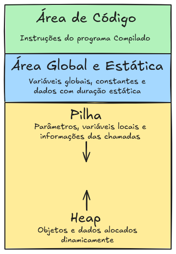
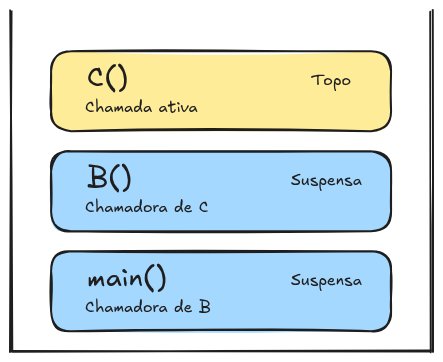
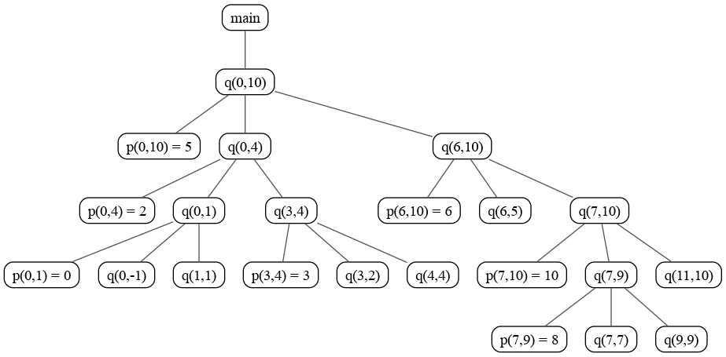
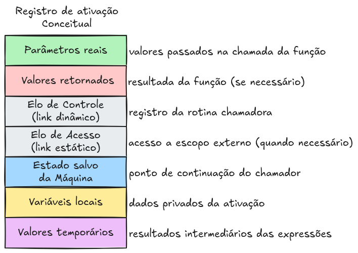
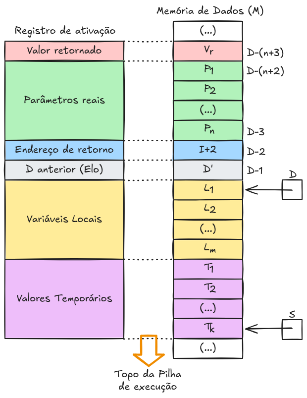
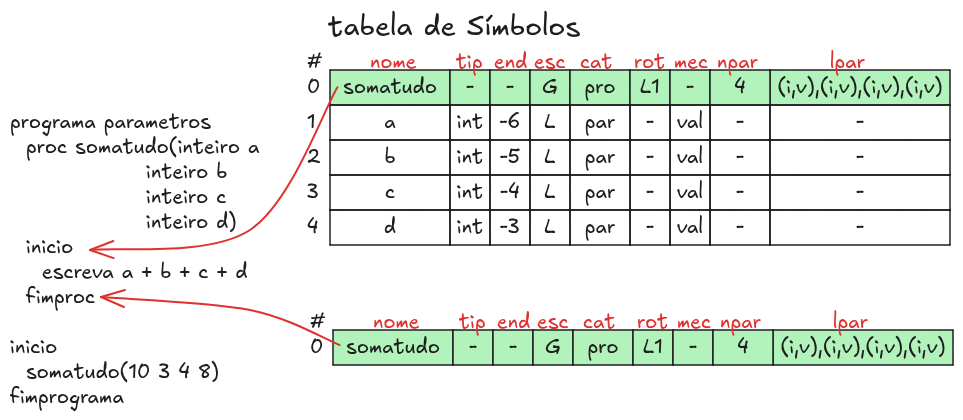
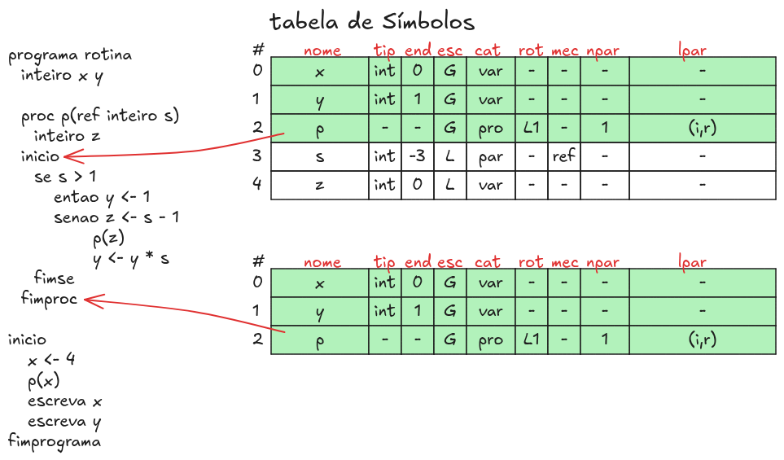
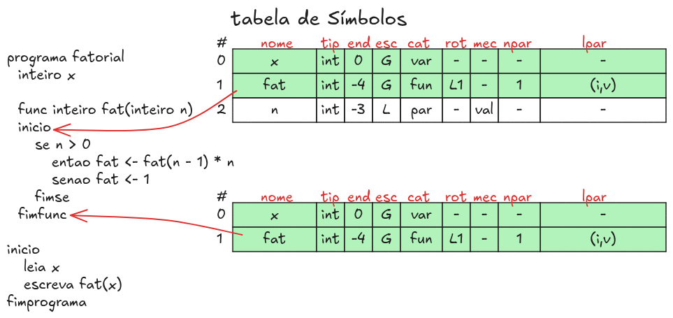

# Projetos de Compiladores

{fig-align="center" width=70%}

A seguir está uma versão desenvolvida para o livro Teoria de Linguagens e Compiladores, mantendo a organização conceitual dos slides e aprofundando as explicações sobre a relação entre compilador, memória, pilha de execução, árvore de ativação e registros de ativação. O texto também estabelece a ligação com o projeto de compilador para a MVS, especialmente com a implementação de funções, procedimentos e passagem de parâmetros.

## Ambientes de execução

A geração de código não encerra o processo de implementação de uma linguagem de programação. Para que um programa compilado possa ser executado corretamente, é necessário estabelecer como suas instruções e seus dados serão organizados na memória e como ocorrerão as chamadas de funções e procedimentos.

Essas decisões envolvem um compromisso entre o compilador, o sistema operacional, a arquitetura da máquina de destino e, quando existente, o ambiente de execução da linguagem. O compilador precisa produzir código que respeite as convenções adotadas por esses componentes, de modo que as instruções geradas possam ser executadas corretamente.

Para isso, considera-se um modelo denominado ambiente de execução (runtime environment). Esse modelo define as estruturas e os mecanismos utilizados durante a execução do programa, incluindo:

- a localização e a alocação do código e dos dados;
- o acesso a variáveis globais, locais e parâmetros;
- o gerenciamento da memória utilizada pelas funções e pelos procedimentos;
- os mecanismos de chamada e retorno de rotinas;
- as convenções de passagem de parâmetros e de retorno de valores;
- a comunicação com o sistema operacional, incluindo operações de entrada e saída.

O ambiente de execução estabelece, portanto, as condições necessárias para que as abstrações da linguagem de programação sejam implementadas sobre uma máquina concreta ou virtual.

Considere uma função que recebe dois parâmetros, realiza uma operação aritmética e retorna o resultado. Para executá-la, não basta que o compilador gere a instrução de adição. Também é necessário determinar onde os parâmetros serão armazenados, como as variáveis locais serão acessadas, onde o resultado será colocado e como o controle retornará ao ponto da chamada.

Essas decisões fazem parte da organização do ambiente de execução. Uma vez estabelecidas, o compilador pode traduzir funções e procedimentos utilizando uma convenção consistente de armazenamento de dados, chamada e retorno.

No caso de uma máquina virtual didática, como a MVS utilizada neste livro, esse ambiente pode ser simplificado para fins pedagógicos. Ainda assim, os mesmos princípios precisam ser considerados quando a linguagem passa a oferecer subprogramas, parâmetros e chamadas recursivas.

### Organização da memória

Durante a execução, um programa utiliza diferentes regiões de memória, cada uma destinada a finalidades específicas. Uma organização conceitual comum distingue a área de código, a área de dados globais ou estáticos, a pilha de execução e a área de alocação dinâmica, denominada heap.

{#fig-organizacao width="30%"}

Uma representação conceitual das regiões de memória está ilustrada na @fig-organizacao. A disposição física e o sentido de crescimento das regiões dependem da plataforma.

A área de código contém as instruções executáveis do programa. Seu conteúdo é produzido pelo compilador ou pelo sistema de ligação e, normalmente, permanece estável durante a execução. Em programas convencionais, o tamanho do código pode ser determinado a partir do executável produzido, embora existam mecanismos que permitem carregar código adicional durante a execução.

A área global ou estática armazena dados cuja duração não depende de uma chamada individual de função. Entre os exemplos estão variáveis globais e variáveis estáticas. O espaço necessário para esses dados pode ser determinado durante a compilação ou a ligação do programa.

A pilha de execução armazena informações relacionadas às chamadas de funções e procedimentos. Cada chamada pode exigir espaço para os parâmetros, as variáveis locais, os valores temporários e o endereço de retorno. Esse espaço é organizado em registros de ativação, que serão estudados adiante.

A heap é utilizada para dados cuja alocação e duração são controladas durante a execução. Por exemplo, um programa pode solicitar memória dinamicamente para armazenar uma estrutura de dados cujo tamanho só é conhecido em tempo de execução. A liberação desse espaço pode ser explícita, como em `free` e `delete`, ou automática, por meio de mecanismos de gerenciamento e coleta de lixo.

É importante distinguir a heap da pilha de execução. A pilha organiza principalmente as informações associadas às chamadas de rotinas, enquanto a heap permite manter objetos e estruturas de dados que precisam existir independentemente do término de uma chamada específica.

Essa divisão é conceitual: sistemas operacionais e arquiteturas reais podem utilizar outras regiões, como áreas de memória mapeadas, bibliotecas compartilhadas e pilhas específicas para diferentes threads.

### Memória estática e dinâmica

A localização dos dados e sua duração são aspectos fundamentais para o gerenciamento da memória.

A alocação estática ocorre quando o espaço necessário para determinados dados é estabelecido antes da execução, geralmente durante a compilação ou a ligação. Variáveis globais e variáveis estáticas são exemplos comuns. Como sua localização é conhecida pelo ambiente de execução, o acesso a esses dados pode ser realizado por endereços previamente determinados.

A alocação dinâmica ocorre durante a execução. O espaço necessário é obtido conforme as operações realizadas pelo programa. A pilha de execução é utilizada para gerenciar as ativações de funções e procedimentos, enquanto a heap é utilizada para objetos e estruturas cuja duração não precisa acompanhar a sequência de chamadas.

Considere o seguinte programa:

```{.c}
int total;

void calcula(int n) {
    int parcial;
    parcial = n * 2;
}
```

A variável global `total` possui duração estática. Já o parâmetro `n` e a variável local `parcial` estão associados à execução de `calcula`. Em uma implementação que utiliza pilha de execução, o espaço para esses dados pode ser reservado em um registro de ativação criado quando a função é chamada e liberado quando ela retorna.

Se a função for chamada várias vezes, cada ativação poderá possuir seus próprios valores para `n` e `parcial`. Essa característica é indispensável para que chamadas sucessivas ou recursivas não compartilhem indevidamente as variáveis locais.

A distinção entre alocação estática e dinâmica não deve ser confundida com a distinção entre pilha e heap. A primeira diz respeito ao momento e à duração da alocação; a segunda identifica regiões e mecanismos de gerenciamento de memória. A pilha, por exemplo, realiza alocação dinâmica em tempo de execução, mesmo que o tamanho de cada registro de ativação possa ser calculado pelo compilador.

## Pilha de execução

A pilha de execução é uma estrutura de dados utilizada para gerenciar as chamadas e os retornos das funções e dos procedimentos. Sua organização segue a disciplina LIFO (Last In, First Out): o último elemento inserido é o primeiro a ser removido.

Quando uma rotina é chamada, o ambiente de execução reserva espaço para as informações necessárias à sua execução. Esse espaço constitui seu registro de ativação. Quando a rotina termina, o registro correspondente é removido, liberando o espaço utilizado e permitindo que a execução continue no ponto de chamada.

Considere o seguinte programa:

```{.c}
void C() {
    /* comandos de C */
}

void B() {
    C();
}

int main() {
    B();
    return 0;
}
```

A execução começa em `main`, que chama `B`. Durante a execução de `B`, ocorre uma chamada a `C`. Nesse momento, as três rotinas possuem ativações vivas: `main`, `B` e `C`.

{#fig-pilha-ativacao width="30%"}

A representação na @fig-pilha-ativacao mostra a ordem lógica dos registros, do topo para a base. A disposição física da memória pode variar.

Quando `C` termina, seu registro de ativação é removido e o controle retorna a `B`. Depois que `B` termina, seu registro é removido, e a execução retorna a `main`. Por fim, a ativação de `main` termina.

A pilha permite que o ambiente de execução preserve o contexto de cada chamada sem precisar reservar antecipadamente um espaço exclusivo para todas as chamadas possíveis de uma rotina. O mesmo código de uma função pode ser executado repetidas vezes, utilizando registros de ativação diferentes.

Essa organização é especialmente importante na recursão. Uma função recursiva chama a si própria, direta ou indiretamente, antes que uma ativação anterior tenha terminado. Cada chamada precisa preservar seus parâmetros, suas variáveis locais e seu endereço de retorno. A pilha oferece um mecanismo natural para organizar essas informações.

### Por que a pilha funciona?

O uso de uma pilha de execução é possível porque as chamadas de funções e procedimentos apresentam uma propriedade de aninhamento. Uma rotina chamada durante a execução de outra precisa terminar antes que a execução da rotina chamadora possa continuar após a chamada, no modelo convencional de chamadas síncronas.

Isso significa que a ordem das ativações e dos retornos é compatível com a disciplina LIFO:

- as ativações são iniciadas na ordem em que as chamadas ocorrem;
- a ativação mais recente precisa terminar antes que a ativação imediatamente anterior possa continuar após a chamada;
- os registros são removidos na ordem inversa àquela em que foram criados.

Essa propriedade explica por que não é necessário procurar arbitrariamente qual ativação deve ser encerrada: em uma execução convencional, o registro no topo da pilha corresponde à rotina atualmente ativa.

A afirmação pressupõe chamadas síncronas convencionais. Corrotinas, continuations, execução assíncrona e outros mecanismos podem exigir estruturas de controle adicionais ou gerenciamento de contexto diferente.

## Árvore de ativação

A árvore de ativação é uma representação conceitual da sequência de chamadas de funções e procedimentos durante a execução de um programa. Ela permite visualizar a relação entre uma ativação e as ativações que ocorrem durante sua execução.

Cada nó da árvore representa uma ativação específica de uma rotina. Se, durante a ativação de uma rotina $A$, ocorre uma chamada que cria a ativação $B$, então $B$ é representada como filha de $A$.

É importante observar que os nós representam chamadas, e não apenas nomes de funções. Se uma função recursiva for chamada várias vezes, cada chamada será representada por um nó distinto, mesmo que todos os nós correspondam ao mesmo código-fonte.

### Exemplo: ordenação por quicksort

Considere o seguinte programa simplificado, que utiliza o algoritmo de ordenação quicksort:

```{.c}
#include <stdio.h>
#include <stdlib.h>
#include <string.h>

#define DEBUG(x) x
#define TAM 10
int a[TAM + 1] = 
  {95, 60, 10, 40, 30, 1, 20, 90, 70, 80, 50};

int partition(int p, int r)
{
    int x = a[r]; /* pivo */
    int i = p - 1;
    int j, temp;
    for (j = p; j < r; j++)
    {
        if (a[j] <= x)
        {
            i++;
            temp = a[i];
            a[i] = a[j];
            a[j] = temp;
        }
    }
    temp = a[i + 1];
    a[i + 1] = a[r];
    a[r] = temp;
    return i + 1;
}

void qSort(int m, int n, int level)
{
    char tab[40] = "";
    for (int i = 0; i < level; i++)
       strcat(tab,"...");
    DEBUG(printf("%sEntra no qSort(%d,%d)\n", tab, m, n);)
    if (m < n)
    {
        int i = partition(m, n);
        qSort(m, i - 1, level+1);
        qSort(i + 1, n, level+1);
    }
    DEBUG(printf("%sSai do qSort(%d,%d)\n", tab, m, n);)
}

int main()
{
    DEBUG(printf("Entra no main()\n");)
    qSort(0, TAM, 1);
    for (int i = 0; i < TAM+1; i++)
      printf("%4d", a[i]);
    puts("");
    DEBUG(printf("Sai do main()\n");)
    return (EXIT_SUCCESS);
}
```

O programa principal chama `qSort`. Durante a execução de `qSort`, ocorre uma chamada a `partition` e, posteriormente, duas chamadas recursivas a `qSort`.

Uma possível sequência simplificada de execução, sem as chamadas a `partition` é:

```
Entra no main()
...Entra no qSort(0,10)
......Entra no qSort(0,4)
.........Entra no qSort(0,1)
............Entra no qSort(0,-1)
............Sai do qSort(0,-1)
............Entra no qSort(1,1)
............Sai do qSort(1,1)
.........Sai do qSort(0,1)
.........Entra no qSort(3,4)
............Entra no qSort(3,2)
............Sai do qSort(3,2)
............Entra no qSort(4,4)
............Sai do qSort(4,4)
.........Sai do qSort(3,4)
......Sai do qSort(0,4)
......Entra no qSort(6,10)
.........Entra no qSort(6,5)
.........Sai do qSort(6,5)
.........Entra no qSort(7,10)
............Entra no qSort(7,9)
...............Entra no qSort(7,7)
...............Sai do qSort(7,7)
...............Entra no qSort(9,9)
...............Sai do qSort(9,9)
............Sai do qSort(7,9)
............Entra no qSort(11,10)
............Sai do qSort(11,10)
.........Sai do qSort(7,10)
......Sai do qSort(6,10)
...Sai do qSort(0,10)
   1  10  20  30  40  50  60  70  80  90  95
Sai do main()
```

A árvore de ativação correspondente pode ser representada da seguinte maneira:

{#fig-qsort1 width="80%"}

Na árvore de ativação da @fig-qsort1 cada nó representa uma chamada específica, e os filhos são as ativações iniciadas durante a execução do nó pai.

Na árvore completa, as chamadas recursivas de `qSort` também podem originar outras chamadas a `partition` e novas ativações de `qSort`, até que os subvetores tenham tamanho suficiente para encerrar a recursão.

A árvore de ativação permite distinguir duas representações importantes: a árvore descreve todas as relações de chamada ocorridas durante a execução considerada, enquanto a pilha representa apenas as ativações que permanecem vivas em um determinado instante.

### Relação entre a árvore de ativação e a pilha

A sequência de chamadas de um programa corresponde a um percurso em pré-ordem na árvore de ativação, considerando que cada nó é visitado quando sua ativação começa e que as chamadas filhas são visitadas na ordem em que ocorrem.

De maneira análoga, a sequência de retornos corresponde a um percurso em pós-ordem, considerando que um nó termina depois de concluídas as ativações filhas.

Em qualquer instante, as ativações vivas formam o caminho entre a raiz da árvore e o nó correspondente à rotina que está em execução. A pilha contém os registros dessas ativações, com o registro da rotina atual no topo.

A @fig-qsort2 apresenta as ativações já finalizadas (na cor verde), as ativações suspensas na pilha de execução (na cor azul), para a chamada ativa `qSort(3,2)`. As ativações que ainda não foram realizadas até este instantes estão representadas com linhas pontilhadas.

{#fig-qsort2 width="90%"}

A pilha contém os registros correspondentes a cinco ativações até a chamada  `qSort(3,2)`. Quando `partition(3,4)` termina, seu registro é removido, e a execução retorna a `qSort(3,4)` que então inicia a primeira chamada `qSort(3,2)`. A pilha de ativação passa então a conter as chamadas `qSort(3,2)`, `qSort(3,4)`, `qSort(0,4)`, `qSort(0,10)` e `main`.

A árvore de ativação oferece, portanto, uma visão global da estrutura de chamadas, enquanto a pilha de execução representa o estado ativo dessa estrutura em um momento específico. Essa relação é fundamental para compreender o gerenciamento de funções, procedimentos e recursão.

A simulação seguinte ilustra o processo de acompanhamento das chamadas recursivas:

::: {.simulacao url="/p5js/ativTree/" height="400" image="/printscreen/ativTree.png" qrcode="/qrcode/ativTree.png"}
:::

## Registro de ativação

Quando uma função ou procedimento é chamado, o ambiente de execução precisa preservar as informações necessárias para que a rotina seja executada corretamente e, ao terminar, retorne ao ponto de chamada. O conjunto dessas informações constitui o registro de ativação, também denominado frame.

Cada ativação possui seu próprio registro. Assim, duas chamadas da mesma função podem compartilhar o código executável, mas manter parâmetros, variáveis locais e endereços de retorno diferentes.

Um registro de ativação pode conter as seguintes informações:

- Parâmetros: valores ou referências recebidos na chamada.
- Variáveis locais: dados declarados no corpo da rotina.
- Valores temporários: resultados intermediários utilizados na avaliação de expressões.
- Estado da máquina: informações que precisam ser preservadas durante a chamada, como registradores utilizados pelo chamador.
- Endereço de retorno: endereço da instrução que deverá ser executada depois que a rotina terminar.
- Elo de controle: referência ao registro de ativação da rotina chamadora.
- Elo de acesso: referência utilizada para localizar dados de escopos lexicais externos, quando a linguagem e sua implementação exigem esse mecanismo.
- Espaço para o resultado: local utilizado para devolver o valor de uma função, conforme a convenção de chamada.

Nem todos os registros de ativação contêm necessariamente todos esses campos. A organização depende da linguagem, da arquitetura e da convenção de chamada. Por exemplo, alguns parâmetros podem ser transmitidos por registradores, e o valor retornado pode ser colocado em um registrador específico, em vez de ocupar uma posição no registro de ativação.

### Organização de um registro de ativação

A @fig-registro-conceitual apresenta uma organização conceitual possível.

{#fig-registro-conceitual width="60%"}

Os campos são ilustrativos. Sua ordem, presença e forma de armazenamento variam conforme a implementação.

O registro é criado quando uma ativação começa e permanece disponível enquanto a rotina está em execução. Quando a rotina termina, o ambiente de execução utiliza as informações necessárias para restaurar o contexto do chamador e liberar o espaço correspondente.

Essa organização permite que o compilador utilize deslocamentos relativos para acessar os dados locais. Por exemplo, uma variável pode ser localizada a partir de um registrador que aponta para uma posição de referência do registro de ativação. O deslocamento da variável pode permanecer constante em diferentes chamadas, mesmo que cada registro esteja localizado em uma posição diferente da memória.


### Elo de controle e elo de acesso

Embora possam ser representados por referências entre registros, o elo de controle e o elo de acesso têm finalidades distintas.

O elo de controle identifica a relação dinâmica entre a rotina chamada e a rotina que a chamou. Ele permite recuperar o contexto anterior quando a execução retorna. Em uma implementação baseada em pilha, essa relação acompanha a sequência efetiva de chamadas.

O elo de acesso permite localizar dados pertencentes a um escopo lexical externo. Ele é relevante em linguagens que permitem declarar rotinas dentro de outras rotinas e acessar variáveis de escopos envolventes. Sua utilização depende das regras de escopo da linguagem e da estratégia de implementação.

Em programas nos quais todas as rotinas são declaradas em um único nível e não existe acesso a variáveis de escopos externos, o elo de acesso pode ser desnecessário.

Essa distinção é importante porque a relação entre rotinas na estrutura lexical do programa não é necessariamente a mesma relação estabelecida pela sequência de chamadas durante a execução.

## Relação com o projeto de compilador para a MVS

Os conceitos apresentados fornecem a base para ampliar o compilador desenvolvido nos capítulos anteriores, permitindo a implementação de funções, procedimentos, passagem de parâmetros e recursão.

No projeto atual, a tabela de símbolos armazena informações sobre os identificadores, incluindo seu nome, endereço e tipo. Para incorporar subprogramas, será necessário acrescentar informações sobre parâmetros formais, tipo de retorno e localização do código correspondente. Também será preciso estabelecer como os parâmetros e as variáveis locais serão armazenados durante cada ativação.

A implementação pode seguir uma sequência incremental:

1. Definir a convenção de chamada e retorno da MVS.
2. Implementar chamadas de procedimentos sem parâmetros.
3. Introduzir parâmetros por valor e verificar quantidade e tipos dos argumentos.
4. Implementar o retorno de valores das funções.
5. Organizar variáveis locais e registros de ativação para permitir chamadas recursivas.
6. Incorporar passagem por referência e, se necessário, mecanismos de acesso a escopos externos.

A MVS precisará oferecer instruções ou mecanismos equivalentes para preservar o endereço de retorno, transferir o controle para o subprograma e restaurar a execução do chamador. Se o conjunto de instruções atual não oferecer esses recursos, será necessário ampliá-lo ou implementar uma convenção de chamada usando as instruções existentes.

A pilha de execução, a árvore de ativação e o registro de ativação descrevem aspectos complementares desse processo. A árvore representa a relação entre as chamadas; a pilha mantém as ativações vivas; e cada registro reúne os dados e o contexto necessários à execução de uma rotina.

Esses conceitos completam o estudo da geração de código ao mostrar que traduzir uma função não significa apenas produzir suas instruções. É necessário também definir como ela recebe argumentos, mantém seu estado durante a execução e devolve o controle ao programa que a chamou.

### Registro de ativação para a MVS

A @fig-registro-mvs mostra uma configuração para construção do registro de ativação para a MVS.

{#fig-registro-mvs width="60%"}

A construção do registro de ativação na MVS começa com a reserva de uma posição na pilha de execução para armazenar o valor de retorno ($V_r$) da rotina. Essa posição é necessária quando a rotina é uma função que retorna um resultado ao seu chamador. No caso de um procedimento, que não retorna valor, essa reserva não é necessária.

Em seguida, os valores dos $n$ argumentos da chamada são empilhados, na ordem estabelecida pela implementação da MVS. Esses valores serão utilizados para inicializar os parâmetros formais ($P_1$, $P_2$,...,$P_n$) da rotina chamada. Dessa maneira, os argumentos ficam disponíveis na pilha para serem acessados durante a execução da rotina.

Antes de transferir o controle para a rotina, é necessário preservar as informações que permitem retomar a execução no ponto em que a chamada ocorreu. Para isso, o endereço de retorno ($i+2$) — isto é, o endereço da instrução que deverá ser executada após o término da rotina — é armazenado na pilha. Também é preservado o valor anterior do registrador `D`, que representa o contexto da rotina chamadora. Essas informações possibilitam restaurar o estado de execução anterior quando a rotina terminar.

Após salvar essas informações, o registrador `D` é atualizado para apontar para a posição da pilha que servirá como referência para o novo registro de ativação. A partir desse ponto, são organizadas as $m$ variáveis locais ($L_1$, $L_2$,...,$L_m$) e $k$ os valores temporários ($T_1$, $T_2$, ..., $T_k$) necessários à execução da rotina. Os temporários são utilizados, por exemplo, para armazenar resultados intermediários produzidos durante a avaliação de expressões.

Ao final da execução da rotina, o processo de encerramento recupera as informações preservadas durante a chamada. O valor do registrador `D` correspondente ao contexto anterior pode ser recuperado da posição `M[D-1]`, enquanto o endereço de retorno do programa é recuperado da posição `M[D-2]`. Em seguida, a pilha é ajustada para remover os elementos utilizados pelo registro de ativação, incluindo os dados de controle e os demais valores associados à execução da rotina.

Considerando que esses elementos ocupam as posições previstas pela convenção de chamada da MVS, a remoção dos  `n` valores dos parâmetros mais as duas posições (`D` anterior e `i+2`), isto é `n+2` valores, permite descartar os elementos do registro de ativação sem eliminar o valor de retorno, quando houver. Assim, se a rotina for uma função, o resultado permanece no topo da pilha, disponível para ser utilizado pela expressão que contém a chamada. Se a rotina for um procedimento, não há valor de retorno a preservar.

Esse mecanismo permite que chamadas de rotinas sejam executadas de maneira aninhada e recursiva. Cada chamada estabelece um novo contexto de execução, preservando as informações necessárias para que, ao terminar, o controle retorne corretamente à rotina chamadora.

### Extensão da Máquina Virtual para Suporte a Subprogramas

A tradução de programas que utilizam funções e procedimentos exige que a máquina virtual ofereça mecanismos para realizar chamadas de subprogramas, transferir argumentos, preservar o contexto de execução e retornar ao ponto em que a chamada foi realizada.

Para implementar essas funcionalidades, a máquina virtual MVS é estendida com um conjunto de instruções específicas para manipulação de variáveis locais, acesso indireto à memória, gerenciamento dos registros de ativação e controle da execução de subprogramas.

A implementação utiliza a pilha de execução para armazenar informações necessárias às chamadas de funções e procedimentos. Cada chamada estabelece um novo contexto de execução, denominado **registro de ativação**, que contém informações associadas à execução da rotina, como parâmetros, variáveis locais e informações de controle.

Nesse mecanismo, três registradores desempenham papel fundamental:

- `s`: indica o topo da pilha de execução;
- `d`: contém o endereço-base do registro de ativação corrente;
- `i`: indica a posição da próxima instrução a ser executada no programa.

A memória da máquina virtual é representada por `M`, sendo `M[x]` o conteúdo da posição de memória `x`.

#### Novas instruções da MVS

A Tabela apresenta as instruções acrescentadas à máquina virtual para permitir a tradução de funções e procedimentos.

| Instrução | Descrição | Microcódigo |
|:---|:---|:---|
| `CRVL n` | Carrega valor local | $s \leftarrow s + 1$ <br> $M[s] \leftarrow M[d + n]$ |
| `ARZL n` | Armazena valor em variável local | $M[d + n] \leftarrow M[s]$ <br> $s \leftarrow s − 1$ |
| `CREL n` | Carrega endereço local | $s \leftarrow s + 1$ <br> $M[s] \leftarrow d + n$ |
| `CREG n` | Carrega endereço global | $s \leftarrow s + 1$ <br> $M[s] \leftarrow n$ |
| `CRVI n` | Carrega valor indireto | $s \leftarrow s + 1$ <br> $M[s] \leftarrow M[M[d + n]]$ |
| `ARMI n` | Armazena valor indireto | $M[M[d + n]] \leftarrow M[s]$ <br> $s \leftarrow s − 1$ |
| `SVCP` | Salva contador do programa | $s \leftarrow s + 1$ <br> $M[s] \leftarrow i + 2$ |
| `ENSP` | Entrada em subprograma | $s \leftarrow s + 1$ <br> $M[s] \leftarrow d$ <br> $d \leftarrow s + 1$ |
| `RTSP n` | Retorno de subprograma | $d \leftarrow M[s]$ <br> $i \leftarrow M[s − 1]$ <br> $s \leftarrow s − (n + 2)$ |

: {tbl-colwidths="[20,40,40]"}

#### Descrição das instruções

##### Manipulação de variáveis locais

As instruções `CRVL`, `ARZL` e `CREL` permitem acessar variáveis locais e seus endereços, utilizando o registrador `d` como referência para o registro de ativação corrente.

**CRVL n – Carrega valor local**

Obtém o conteúdo da variável localizada no deslocamento `n`, relativo ao endereço-base do registro de ativação, e coloca esse valor no topo da pilha.

A instrução realiza duas operações: incrementa o ponteiro da pilha e copia o conteúdo de `M[d+n]` para a nova posição.

**ARZL n – Armazena valor local**

Armazena o valor que está no topo da pilha na posição correspondente à variável local identificada pelo deslocamento `n`.

Após realizar a atribuição, decrementa o ponteiro da pilha, removendo o valor utilizado.

**CREL n – Carrega endereço local**

Obtém o endereço de uma variável local, calculado por `d+n`, e coloca esse endereço no topo da pilha.

Diferentemente de `CRVL`, essa instrução não carrega o conteúdo da variável, mas seu endereço. Isso permite implementar operações que necessitam de referências a variáveis, como passagem de parâmetros por referência.

##### Acesso a variáveis globais e indiretas

As instruções `CREG`, `CRVI` e `ARMI` complementam os mecanismos de acesso à memória.

**CREG n – Carrega endereço global**

Coloca no topo da pilha o endereço `n` de uma variável global.

O endereço é armazenado diretamente na pilha, sem realizar a leitura do conteúdo da posição de memória correspondente.

**CRVI n – Carrega valor indireto**

Obtém o conteúdo de uma posição de memória cujo endereço está armazenado na posição `M[d+n]`.

A operação utiliza dois níveis de acesso à memória:

1. Obtém o endereço armazenado em `M[d+n]`.
2. Recupera o conteúdo da posição indicada por esse endereço e o coloca no topo da pilha.

Essa instrução é particularmente útil para implementar o acesso a parâmetros passados por referência.

**ARMI n – Armazena valor indireto**

Realiza uma atribuição indireta. O valor que está no topo da pilha é armazenado na posição de memória cujo endereço está armazenado em `M[d+n]`.

Após a operação, o ponteiro da pilha é decrementado.

##### Controle de chamadas de subprogramas

As instruções `SVCP`, `ENSP` e `RTSP` implementam o mecanismo de chamada e retorno de funções e procedimentos.

**SVCP – Salva contador do programa**

Salva na pilha o endereço da instrução que deverá ser executada após o retorno do subprograma.

A operação utiliza `i+2`, considerando que a instrução consecutiva é o desvio para o rótulo de entrada no subprograma, desta forma o endereço de retorno do contador de programa é o endereço atual `i` mais duas posições.

Esse endereço permite que a execução retorne ao ponto imediatamente posterior à chamada.

**ENSP – Entrada em subprograma**

Realiza a preparação do novo registro de ativação.

Inicialmente, salva na pilha o valor corrente de `d`, preservando o endereço-base do registro de ativação do programa chamador. Em seguida, atualiza `d`, estabelecendo a referência para o novo registro de ativação.

Dessa maneira, cada chamada passa a possuir seu próprio contexto de execução, permitindo a existência de chamadas aninhadas e recursivas.

**RTSP n – Retorno de subprograma**

Realiza o encerramento da execução de uma função ou procedimento.

A instrução executa três operações:

1. Recupera o endereço-base do registro de ativação anterior, restaurando o valor de `d`.
2. Recupera o endereço de retorno e o coloca no registrador `i`, transferindo o controle para a instrução seguinte à chamada.
3. Atualiza o ponteiro da pilha, removendo os elementos associados à chamada, incluindo os parâmetros e as informações de controle, preservando o valor de retorno, se for o caso.

O operando `n` representa a quantidade de parâmetros utilizada no cálculo da desalocação. O termo `n+2` considera os parâmetros e as duas posições de controle utilizadas pelo mecanismo de chamada: endereço de retorno e endereço-base anterior.

#### Funcionamento de uma chamada de subprograma

O processo de chamada de uma função ou procedimento envolve a preparação dos argumentos, o armazenamento das informações de controle e a criação de um novo registro de ativação.

De maneira geral, o processo pode ser dividido nas seguintes etapas:

1. **Preparação dos parâmetros:** os argumentos da chamada são avaliados e disponibilizados na pilha, conforme a convenção de passagem de parâmetros adotada pelo compilador.
2. **Salvamento do endereço de retorno:** a instrução `SVCP` armazena na pilha o endereço da próxima instrução a ser executada após o retorno.
3. **Criação do registro de ativação:** a instrução `ENSP` salva o endereço-base anterior e estabelece um novo valor para o registrador `d`.
4. **Execução do subprograma:** as instruções da rotina acessam seus parâmetros e variáveis locais utilizando os deslocamentos relativos a `d`.
5. **Retorno ao programa chamador:** a instrução `RTSP n` restaura o contexto anterior, recupera o endereço de retorno e libera o espaço ocupado pelos parâmetros e informações de controle.

A utilização de registros de ativação na pilha permite que uma mesma rotina seja chamada várias vezes, inclusive durante sua própria execução. Essa característica é fundamental para implementar procedimentos aninhados e algoritmos recursivos.


### Projeto de compilador com funções, procedimentos e passagem de parâmetros

Nos capítulos anteriores, desenvolvemos os principais componentes de um compilador para uma linguagem de programação simples: análise léxica, análise sintática, análise semântica e geração de código para a Máquina Virtual Simples (MVS). A linguagem implementada permite declarar variáveis, realizar operações aritméticas e lógicas, executar comandos de atribuição e utilizar estruturas de controle, como seleção e repetição.

Embora esses recursos sejam suficientes para implementar algoritmos de pequena complexidade, programas maiores exigem mecanismos que favoreçam a modularização e o reaproveitamento de código. As funções e os procedimentos atendem a essa necessidade ao permitir que um programa seja dividido em unidades menores, cada uma responsável por realizar uma tarefa específica.

Uma função executa um conjunto de comandos e devolve um resultado ao programa que a chamou. Um procedimento também executa um conjunto de comandos, mas não precisa retornar um valor como resultado de uma expressão. Essa distinção permite organizar o programa em operações que produzem valores e operações destinadas à realização de ações.

A utilização dessas construções introduz novos desafios para o compilador. Além de reconhecer as declarações e as chamadas, é necessário verificar a quantidade e os tipos dos parâmetros, controlar o escopo dos identificadores e gerar instruções que permitam transferir a execução entre o programa principal e os subprogramas.

Também é necessário estabelecer como os argumentos são transmitidos, como as variáveis locais são armazenadas e como a execução retorna ao ponto em que ocorreu a chamada. Essas responsabilidades envolvem tanto a análise semântica quanto a geração de código e a organização da memória durante a execução.

Neste capítulo, ampliaremos o projeto de compilador para contemplar declarações de funções e procedimentos, chamadas de subprogramas e diferentes formas de passagem de parâmetros. O objetivo é compreender como os conceitos estudados anteriormente podem ser estendidos para construir uma linguagem de programação com recursos de abstração e modularização mais expressivos.

### Declaração de funções e procedimentos

Uma função ou um procedimento é uma unidade de programa identificada por um nome e constituída, em geral, por uma lista de parâmetros, declarações locais e um corpo de comandos.

Uma declaração de função especifica o tipo do valor que será devolvido. Por exemplo:

```{.simples}
func inteiro soma(inteiro a inteiro b)
inicio
    soma <- a + b
fimfunc
```

A função `soma` recebe dois parâmetros inteiros, `a` e `b`, e retorna a soma de seus valores. O tipo declarado após os parâmetros indica que o resultado da função é inteiro.

Um procedimento pode ser declarado da seguinte forma:

```{.simples}
proc imprime(inteiro valor)
inicio
    escreva valor
fimproc
```

Nesse exemplo, o procedimento `imprime` recebe um parâmetro inteiro e apresenta seu valor. Não há um resultado a ser utilizado em uma expressão, embora a execução do procedimento possa produzir efeitos, como a escrita de dados.

Os exemplos utilizam uma notação ilustrativa para as declarações. A sintaxe efetivamente adotada pelo compilador deverá ser definida pela gramática da linguagem.

A inclusão dessas construções exige que o compilador reconheça novos elementos sintáticos, entre eles:

- declarações de funções e procedimentos;
- listas de parâmetros formais;
- tipos de parâmetros e de retorno;
- comandos de retorno;
- chamadas de funções e procedimentos;
- listas de argumentos efetivos.

Esses elementos precisam ser incorporados à gramática e associados a regras semânticas que garantam a consistência das declarações e das chamadas.

### Parâmetros formais e argumentos efetivos

Os parâmetros permitem que um subprograma receba informações do ambiente que o invoca. Para compreender seu funcionamento, é importante distinguir parâmetros formais de argumentos efetivos.

Os **parâmetros formais** são os identificadores declarados na definição da função ou do procedimento. No exemplo anterior, `a` e `b` são os parâmetros formais da função `soma`.

Os **argumentos efetivos** são os valores ou as expressões fornecidos no momento da chamada. Por exemplo:

```{.simples}
resultado <- soma(10, 20)
```

Nessa chamada, `10` e `20` são os argumentos efetivos correspondentes aos parâmetros formais `a` e `b`.

Durante a compilação, o compilador precisa verificar se a chamada respeita a declaração do subprograma. No exemplo, a função espera dois argumentos inteiros. Uma chamada com apenas um argumento ou com tipos incompatíveis deve ser rejeitada, de acordo com as regras da linguagem.

A verificação envolve pelo menos três propriedades:

1. **Quantidade de argumentos:** o número de argumentos deve ser compatível com o número de parâmetros declarados.
2. **Compatibilidade de tipos:** cada argumento deve ser compatível com o tipo do parâmetro correspondente.
3. **Ordem dos argumentos:** cada argumento deve ser associado ao parâmetro correto, conforme a posição ou as regras de associação definidas pela linguagem.

Considere a seguinte chamada:

```{.simples}
resultado <- soma(10)
```

Se a função exigir dois parâmetros, a chamada apresenta um erro semântico, pois a quantidade de argumentos é insuficiente. Da mesma forma, uma chamada como `soma(10, verdadeiro)` será inválida se o segundo parâmetro exigir um valor inteiro e a linguagem não permitir a conversão do valor lógico.

Essas verificações dependem das informações armazenadas na tabela de símbolos. Portanto, a representação dos identificadores deverá ser ampliada para registrar não apenas as variáveis, mas também as funções e os procedimentos, incluindo suas listas de parâmetros e, no caso das funções, o tipo de retorno.

### Passagem de parâmetros

A passagem de parâmetros determina como os argumentos fornecidos na chamada são disponibilizados ao subprograma. Existem diferentes mecanismos, e a escolha influencia tanto o comportamento do programa quanto a implementação do compilador e da máquina virtual.

#### Passagem por valor

Na passagem por valor, o subprograma recebe uma cópia do valor do argumento. Alterações realizadas no parâmetro formal não modificam diretamente a variável utilizada na chamada.

Considere o procedimento:

```{.simples}
proc incrementa(inteiro x)
inicio
    x <- x + 1
fimproc
```

Suponha que o programa principal execute:

```{.simples}
inteiro a
a <- 5
incrementa(a)
```

Com passagem por valor, o procedimento recebe uma cópia do valor `5`. Ao executar `x = x + 1`, o parâmetro local passa a valer `6`, mas a variável `a` permanece com o valor `5`.

Esse mecanismo exige que o compilador transmita o valor do argumento e que o ambiente de execução disponibilize um espaço de armazenamento para o parâmetro formal.

Na MVS, uma implementação possível consiste em avaliar o argumento, colocar seu valor na pilha de execução e copiá-lo para a posição de memória associada ao parâmetro formal durante a ativação do subprograma.

#### Passagem por referência

Na passagem por referência, o parâmetro formal permite acessar a própria variável associada ao argumento, em vez de receber apenas uma cópia de seu valor. Dessa forma, as modificações realizadas no subprograma podem ser observadas pelo programa que o chamou.

Considere o mesmo procedimento `incrementa`, agora com o parâmetro declarado por referência:

```{.simples}
proc incrementa(ref inteiro x)
inicio
    x <- x + 1
fimproc
```

Ao executar:

```{.simples}
inteiro a
a <- 5
incrementa(a)
```

o procedimento acessa a variável original. Ao final da chamada, `a` passa a valer `6`.

Para implementar esse mecanismo, o compilador precisa transmitir uma referência à variável, normalmente representada por seu endereço. O acesso ao parâmetro formal deve utilizar essa referência para ler ou modificar o conteúdo da posição de memória correspondente.

Nem toda expressão pode ser utilizada como argumento de um parâmetro por referência. Em uma implementação convencional, o argumento deve designar uma posição de armazenamento válida, como uma variável. Uma constante ou uma expressão aritmética, por exemplo, não pode ser tratada diretamente como uma variável modificável sem regras adicionais.

#### Comparação entre os mecanismos

| Característica                | Passagem por valor                         | Passagem por referência                     |
| ----------------------------- | ------------------------------------------ | ------------------------------------------- |
| Informação transmitida        | Valor do argumento                         | Referência à variável                       |
| Alteração do parâmetro formal | Não altera diretamente a variável original | Pode alterar a variável original            |
| Armazenamento                 | Cópia do valor                             | Referência ou endereço                      |
| Uso frequente                 | Fornecimento de dados                      | Consulta e modificação de dados do chamador |

A linguagem implementada no projeto poderá adotar apenas passagem por valor inicialmente e, posteriormente, incorporar passagem por referência. Essa evolução permite compreender o mecanismo básico de chamada antes de introduzir o tratamento de endereços e os efeitos das alterações sobre as variáveis do programa principal.


### Modificações na gramática

As regras para declaração de funções e procedimentos pode ser incluído da seguinte forma na gramática:

```c
programa 
  : cabecalho 
    variaveis 
    rotinas
    T_INICIO lista_comandos T_FIM 

cabecalho 
  : T_PROGRAMA T_IDENTIF ;

rotinas 
  : /* vazia */
  | lista_rotinas;

lista_rotinas
  : lista_rotinas rotina
  | rotina;

rotina 
  : funcao 
  | procedimento;

funcao 
  : T_FUNC tipo T_IDENTIF
    T_ABRE lista_parametros T_FECHA
    variaveis
    T_INICIO lista_comandos T_FIMFUNC 
    ;

procedimento 
  : T_PROC T_IDENTIF
    T_ABRE lista_parametros T_FECHA
    variaveis
    T_INICIO lista_comandos T_FIMPROC 
    ;

lista_parametros 
  : /* vazia */
  | lista_parametros parametro;

parametro 
  : mecanismo tipo T_IDENTIF 
    ;

mecanismo 
  : /* vazia */ 
  | T_REF; 
```

As chamadas de funções e procedimentos também são diferentes. As funções são chamadas nas expressões e o procedimento é chamado como um comando. As modificações na gramática então ficam:

```c
(...)
comando 
  : entrada_saida 
  | repeticao 
  | selecao 
  | atribuicao
  | chamada_procedimento 
  ;

chamada_procedimento
  : T_IDENTIF T_ABRE argumentos T_FECHA;

(...)

termo 
  : T_IDENTIF 
  | T_IDENTIF T_ABRE argumentos T_FECHA;

(...)

argumentos 
  : /* vazia */
  | lista_argumentos ;

lista_argumentos 
  : lista_argumentos expressao 
  | expressao
  ;

```

### Escopo e tabela de símbolos

A introdução de funções e procedimentos exige ampliar a tabela de símbolos utilizada nos projetos anteriores. Até aqui, cada identificador armazenava informações como nome, endereço e tipo. Com os novos recursos, o compilador deverá distinguir variáveis, funções e procedimentos.

Para uma função, por exemplo, a tabela poderá armazenar:

- nome da função;
- categoria do identificador;
- tipo do valor retornado;
- quantidade de parâmetros;
- tipos dos parâmetros;
- mecanismos de passagem dos parâmetros;
- informações necessárias à geração do código da chamada.

Para um procedimento, as informações serão semelhantes, exceto pelo tipo de retorno, que não representa um valor utilizado em expressões.

Também será necessário tratar o escopo dos identificadores. Uma variável declarada dentro de uma função pode ter existência e visibilidade restritas ao corpo dessa função. Outra função poderá declarar uma variável com o mesmo nome, sem que isso implique necessariamente um conflito.

Para representar esses contextos, uma solução consiste em manter uma tabela de símbolos associada a cada escopo ou utilizar uma tabela organizada em níveis. Quando o compilador entra em uma função ou procedimento, cria ou ativa o escopo correspondente. Ao terminar o processamento da declaração, encerra esse escopo, preservando as informações globais que continuam válidas.

Essa organização evita que parâmetros e variáveis locais sejam confundidos com identificadores de outras unidades do programa. Além disso, permite detectar usos de variáveis fora de seu escopo e chamadas a funções ou procedimentos não declarados, conforme as regras da linguagem.

### Ativação de funções e procedimentos

Durante a execução, cada chamada de função ou procedimento cria uma nova ativação do subprograma. Essa ativação reúne as informações necessárias para executar o corpo do subprograma e retornar ao ponto de chamada.

Uma implementação convencional utiliza um registro de ativação, também conhecido como quadro de ativação (*activation record*). Ele pode conter:

- parâmetros recebidos;
- variáveis locais;
- endereço de retorno;
- informações de controle da chamada;
- espaço para o resultado da função, quando necessário.

A organização exata depende da máquina virtual e da convenção de chamada adotada. Em uma máquina baseada em pilha, os registros de ativação podem ser organizados em uma pilha de chamadas, permitindo que uma função invoque outra e que chamadas recursivas mantenham dados independentes para cada ativação.

Considere:

```{.simples}
func inteiro quadrado(inteiro x)
inicio
    quadrado <- x * x
fimfunc
```

Quando o programa executa `quadrado(5)`, o ambiente de execução disponibiliza o parâmetro `x`, executa a multiplicação e devolve o resultado `25` ao ponto da chamada.

Se a função `quadrado` for chamada novamente antes de a execução anterior terminar, cada ativação deverá preservar seu próprio valor de `x` e seu próprio endereço de retorno. Esse requisito é fundamental para permitir recursão.

No compilador para a MVS, será necessário definir como os parâmetros e as variáveis locais serão organizados na memória e como o endereço de retorno será preservado. Caso a máquina virtual não ofereça diretamente essas operações, será necessário implementar uma convenção de chamada por meio das instruções disponíveis ou ampliar o conjunto de instruções da máquina.

### Geração de código para chamadas

A geração de código deve traduzir a chamada de uma função ou procedimento em uma sequência de operações que prepare os argumentos, transfira a execução ao subprograma e permita o retorno ao chamador.

Para uma chamada como:

```{.simples}
resultado <- soma(10 20)
```

o compilador deverá gerar código que, conceitualmente, realize as seguintes operações:

1. Avalie os argumentos na ordem definida pela linguagem.
2. Disponibilize os valores ou referências aos parâmetros formais.
3. Preserve as informações necessárias para retornar ao ponto da chamada.
4. Transfira o controle para o código da função.
5. Execute o corpo da função e obtenha o resultado.
6. Retorne ao chamador e disponibilize o valor retornado para completar a atribuição.

O código concreto dependerá das instruções oferecidas pela MVS. Se a máquina virtual possuir instruções específicas para chamada e retorno, elas poderão ser utilizadas diretamente. Caso contrário, será necessário construir uma sequência equivalente usando desvios, pilha e posições de memória reservadas para o controle das chamadas.

É importante distinguir a chamada do subprograma de sua declaração. A declaração define o corpo da função ou do procedimento, enquanto a chamada transfere a execução para esse corpo em um ponto específico do programa.

Para evitar que o programa execute o corpo de uma função apenas por ele aparecer no arquivo gerado, o compilador deverá organizar os rótulos e desvios de maneira que a execução normal passe pelo programa principal e alcance cada subprograma somente quando houver uma chamada correspondente.

#### Retorno de funções

Uma função precisa devolver um valor compatível com o tipo declarado. O comando de atribuição para variável com o nome da função pode ser utilizado para indicar o resultado:

```{.simples}
func inteiro soma(inteiro a, inteiro b)
inicio
    soma <- a + b
fimfunc
```

O compilador deverá verificar se a expressão retornada é compatível com o tipo da função. Também deverá definir as regras para funções que terminam sem executar um comando de retorno, incluindo a possibilidade de rejeitar essas situações durante a análise semântica.

Na geração de código, o resultado poderá ser colocado em uma posição da pilha, em um espaço reservado no registro de ativação ou em outro local definido pela convenção de chamada. A instrução de retorno deverá restaurar o fluxo de execução e disponibilizar o valor ao chamador.

#### Retorno de procedimentos

Um procedimento não precisa devolver um valor para ser utilizado em uma expressão. Seu término deve apenas permitir que a execução retorne ao ponto da chamada.

Por exemplo:

```{.simples}
proc mensagem()
inicio
    escreva 1
fimproc
```

Uma chamada a `mensagem()` executa o corpo do procedimento e, ao final, retorna ao comando seguinte. O compilador deverá garantir que o retorno não deixe valores indevidos na pilha e que a memória temporária utilizada durante a ativação seja liberada de acordo com a convenção adotada.

### Exemplos de tradução

Apresentamos, a seguir, alguns exemplos de tradução que podem servir de referência para o desenvolvimento do compilador, contemplando a tradução de procedimentos e funções com passagem de parâmetros por valor ou por referência. Para ilustrar esse processo, as imagens seguintes apresentam os valores registrados na tabela de símbolos durante a declaração das rotinas e após sua conclusão, quando o compilador retorna ao contexto global.

**Exemplo 1**

```{.simples}
programa parametros
  proc somatudo(inteiro a 
                 inteiro b 
                 inteiro c 
                 inteiro d)
  inicio
    escreva a + b + c + d
  fimproc
  
inicio
  somatudo(10 3 4 8)
fimprograma
```
A Figura @fig-exemplo1 ilustra o comportamento da tabela de símbolos durante a compilação da declaração do procedimento `somatudo`. Inicialmente, ao identificar a declaração da rotina, o compilador registra uma entrada correspondente ao procedimento e, em seguida, inclui os seus quatro parâmetros (`a`, `b`, `c` e `d`). Para cada parâmetro, são armazenadas informações como nome, tipo, endereço relativo, escopo, categoria e mecanismo de passagem. Nesse exemplo, todos os parâmetros são do tipo inteiro e são passados por valor (`val`).

Durante a compilação do corpo do procedimento, os parâmetros permanecem registrados na tabela de símbolos e associados ao escopo local da rotina (`L`). Os endereços relativos atribuídos aos parâmetros são utilizados pelo compilador para orientar o acesso aos respectivos valores durante a execução. Além disso, a entrada do procedimento contém informações sobre sua identificação, seu rótulo (`L1`) para onde deve ser desviada a execução na chamada da rotina, a quantidade de parâmetros (`npar = 4`) e suas respectivas características de passagem, representadas na coluna lista de parâmetros `lpar` (onde `i` ou `l` indica o tipo do parâmetro, inteiro ou lógico, respectivamente e `v` ou `r`, indica o tipo de passagem, valor ou referência, respectivamente).

Após a compilação do procedimento, ao encontrar a instrução `fimproc`, o compilador encerra o escopo local e remove da tabela de símbolos as entradas correspondentes aos parâmetros. Entretanto, a entrada do procedimento é preservada no escopo global (`G`), mantendo as informações necessárias para sua identificação e posterior utilização no restante do programa. Dessa forma, quando o compilador encontra a chamada `somatudo(10 3 4 8)`, pode consultar a tabela de símbolos para verificar a existência da rotina, a quantidade de argumentos esperados e as características de passagem dos parâmetros, orientando a geração do código correspondente à chamada.

{#fig-exemplo1 width="90%"}

O resultado da compilação é:

```{.mvs}
	INPP
	DSVS	L0
L1	ENSP
	CRVL	-6
	CRVL	-5
	SOMA
	CRVL	-4
	SOMA
	CRVL	-3
	SOMA
	ESCR
	RTSP	4
L0	NADA
	CRCT	10
	CRCT	3
	CRCT	4
	CRCT	8
	SVCP
	DSVS	L1
	FIMP
```

O código apresentado corresponde à tradução do programa que declara e utiliza o procedimento `somatudo`, responsável por receber quatro parâmetros inteiros, calcular a soma de seus valores e apresentar o resultado na saída padrão. A tradução é organizada em duas partes: a implementação do procedimento e o programa principal, que realiza sua chamada.

_Inicialização e desvio para o programa principal_

```{.mvs}
    INPP
    DSVS    L0
```

A instrução `INPP` inicializa a execução do programa, preparando as estruturas necessárias para o seu funcionamento. Em seguida, `DSVS L0` realiza um desvio incondicional para o rótulo `L0`, evitando que o fluxo de execução passe diretamente pelo código do procedimento. Essa estratégia permite que a execução comece pelo programa principal, deixando o corpo do procedimento disponível para ser executado somente quando ocorrer uma chamada.

_Implementação do procedimento `somatudo`_

```{.mvs}
L1  ENSP
    CRVL    -6
    CRVL    -5
    SOMA
    CRVL    -4
    SOMA
    CRVL    -3
    SOMA
    ESCR
    RTSP    4
```

O rótulo `L1` identifica o ponto de entrada do procedimento. A instrução `ENSP` inicia a execução da rotina, preparando o ambiente necessário para seu processamento.

As instruções `CRVL` recuperam os valores dos parâmetros armazenados na memória, utilizando seus endereços relativos. Nesse exemplo, os deslocamentos `-6`, `-5`, `-4` e `-3` correspondem, respectivamente, aos parâmetros `a`, `b`, `c` e `d`.

A instrução `SOMA` realiza a adição dos dois valores disponíveis no topo da pilha. Dessa maneira, o código executa sucessivamente as operações necessárias para calcular:

```{.msv} 
a+b+c+d
```

Após o cálculo, a instrução `ESCR` apresenta o resultado na saída padrão. Finalmente, `RTSP 4` encerra a execução do procedimento e retorna ao ponto de chamada, considerando a quantidade de quatro parâmetros utilizados pela rotina.

_Execução do programa principal_

```{.mvs}
L0  NADA
    CRCT    10
    CRCT    3
    CRCT    4
    CRCT    8
    SVCP
    DSVS    L1
    FIMP
```

O rótulo `L0` marca o início do programa principal. A instrução `NADA` não realiza nenhuma operação, sendo utilizada apenas como referência para o desvio efetuado anteriormente.

As quatro instruções `CRCT` empilham os valores constantes `10`, `3`, `4` e `8`, que serão utilizados como argumentos na chamada do procedimento. Em seguida, `SVCP` salva o endereço da instrução que deverá ser executada quando a chamada do procedimento for encerrado e a execução retornar para o programa principal, de acordo com a convenção de passagem de parâmetros adotada pela máquina.

A instrução `DSVS L1` transfere o fluxo de execução para o endereço identificado pelo rótulo `L1`, iniciando a execução do procedimento `somatudo`. Após a conclusão da rotina, a instrução `RTSP 4` realiza o retorno ao programa principal, permitindo que a execução prossiga na instrução seguinte à chamada, que, nesse caso, é `FIMP`.

Por fim, `FIMP` indica o término da execução do programa.

_Resultado da execução_

Considerando a chamada:

```{.mvs}
somatudo(10 3 4 8)
```

o procedimento recebe os valores correspondentes aos seus quatro parâmetros e realiza as seguintes operações:

$$ 10+3=13 $$

$$ 13+4=17 $$

$$ 17+8=25 $$

Saída esperada

```
25
```

Esse exemplo demonstra como o compilador traduz a declaração de um procedimento e sua respectiva chamada, incluindo a organização dos parâmetros na pilha, o acesso aos valores por meio de endereços relativos, o desvio para a rotina e o retorno ao fluxo de execução do programa principal.

**Exemplo 2**

```{.simples}
programa rotina
  inteiro x y
  
  proc p(ref inteiro s)
    inteiro z
  inicio
    se s > 1
       entao y <- 1
       senao z <- s - 1
             p(z)
             y <- y * s
    fimse
  fimproc

inicio
   x <- 4
   p(x)
   escreva x
   escreva y
fimprograma
```

A Figura @fig-exemplo2 apresenta a organização da tabela de símbolos durante a compilação da declaração do procedimento `p`, que possui um parâmetro passado por referência e uma variável local. O exemplo permite observar como o compilador registra as variáveis globais, as informações da rotina, os parâmetros e as variáveis locais, bem como o comportamento da tabela de símbolos após o encerramento da declaração do procedimento.

_Variáveis globais e declaração do procedimento_

Inicialmente, o programa declara duas variáveis inteiras, `x` e `y`, que são registradas na tabela de símbolos com os seguintes valores:

- `x`: variável do tipo inteiro, com endereço real `0`, escopo global (`G`) e categoria `var`.
- `y`: variável do tipo inteiro, com endereço real `1`, escopo global (`G`) e categoria `var`.

Essas variáveis permanecem disponíveis durante toda a execução do programa, inclusive dentro dos procedimentos e funções declarados.

Na sequência, o compilador identifica a declaração do procedimento `p`, cujo parâmetro `s` é do tipo inteiro e utiliza passagem por referência. A entrada correspondente ao procedimento apresenta as seguintes informações:

- **nome**: identificação da rotina (`p`).
- **tipo**: não se aplica, pois se trata de um procedimento, que não possui valor de retorno.
- **esc**: escopo global (`G`), indicando que a rotina foi declarada no nível global do programa.
- **cat**: categoria `pro`, identificando uma declaração de procedimento.
- **rot**: rótulo `L1`, que identifica o endereço de entrada do código gerado para a rotina.
- **npar**: quantidade de parâmetros, nesse caso, `1`.
- **lpar**: informações sobre os parâmetros, representadas por `(i,r)`, indicando que o parâmetro é do tipo inteiro (`i`) e utiliza passagem por referência (`r`).

_Parâmetros e variáveis locais do procedimento_

Durante a compilação do corpo do procedimento, o compilador registra também os identificadores pertencentes ao escopo local (`L`). Nesse exemplo, são registradas duas entradas:

- `s`: parâmetro do tipo inteiro, com endereço relativo `-3`, escopo local (`L`), categoria `par` e mecanismo de passagem `ref`, indicando que seu valor é acessado por referência. O endereço relativo negativo decorre da convenção de organização dos parâmetros no ambiente de execução da MVS.
- `z`: variável local do tipo inteiro, com endereço relativo `0`, escopo local (`L`) e categoria `var`. Como se trata de uma variável declarada dentro do procedimento, seu armazenamento pertence ao ambiente de execução da rotina.

É importante observar que, embora `s` seja um parâmetro formal, ele também é registrado na tabela de símbolos como uma entidade pertencente ao escopo local do procedimento. A informação sobre o mecanismo de passagem é armazenada separadamente, permitindo ao compilador distinguir parâmetros passados por valor daqueles passados por referência.

_Tabela de símbolos após o encerramento do procedimento_

A segunda tabela apresenta a situação após a compilação da declaração do procedimento, quando o compilador encontra a instrução `fimproc`.

Nesse momento, as entradas correspondentes ao parâmetro `s` e à variável local `z` são removidas, pois pertencem ao escopo local da rotina, que foi encerrado.

Entretanto, permanecem na tabela as entradas referentes às variáveis globais `x` e `y` e ao procedimento `p`. A entrada do procedimento conserva suas informações de identificação, seu rótulo de código (`L1`), a quantidade de parâmetros (`npar = 1`) e suas características de passagem (`par = (i,r)`).

Essa preservação é necessária porque o procedimento poderá ser chamado em diferentes pontos do programa, e o compilador precisa consultar suas informações para verificar a quantidade, os tipos e os mecanismos de passagem dos argumentos utilizados nas chamadas.

_A passagem por referência_

O exemplo também ilustra a diferença entre o registro de um parâmetro passado por referência e o de uma variável local. Enquanto o parâmetro `s` possui o mecanismo `ref` e utiliza um endereço relativo negativo, a variável `z` é armazenada diretamente no ambiente local do procedimento.

Essa distinção é particularmente importante para a geração de código. Quando o procedimento modifica o parâmetro `s`, a alteração deve refletir diretamente na variável utilizada como argumento na chamada. Por outro lado, as operações realizadas sobre `z` afetam apenas a variável local da execução corrente do procedimento.

Assim, a tabela de símbolos mantém as informações necessárias para que o compilador gere corretamente o código de acesso às variáveis, respeitando seus escopos e os mecanismos de passagem de parâmetros.

Observação sobre o exemplo: na chamada `p(x)`, o parâmetro formal `s` recebe uma referência à variável global `x`. Portanto, quando o procedimento executa `s <- 1`, está modificando diretamente o conteúdo de `x`. Essa característica permite ilustrar o efeito da passagem por referência sobre as variáveis do programa chamador.

{#fig-exemplo2 width="90%"}

E o resultado do código compilado para MVS é:

```{.mvs}
    INPP
	AMEM	2
	DSVS	L0
L1	ENSP
	AMEM	1
	CRVI	-3
	CRCT	1
	CMMA
	DSVF	L2
	CRCT	1
	ARZG	1
	DSVS	L3
L2	NADA
	CRVI	-3
	CRCT	1
	SUBT
	ARZL	0
	CREL	0
	SVCP
	DSVS	L1
	CRVG	1
	CRVI	-3
	MULT
	ARZG	1
L3	NADA
	DMEM	1
	RTSP	1
L0	NADA
	CRCT	4
	ARZG	0
	CREG	0
	SVCP
	DSVS	L1
	CRVG	0
	ESCR
	CRVG	1
	ESCR
	DMEM	2
	FIMP
```

O código apresentado corresponde à tradução para a máquina virtual MVS de um programa que declara um procedimento recursivo `p`, cujo parâmetro inteiro `s` é passado por referência. O procedimento também utiliza uma variável local `z` e uma variável global `y`.

A implementação contém uma estrutura condicional que verifica se o parâmetro `s` é maior que um. Caso a condição seja verdadeira, atribui o valor um à variável global `y`. Caso contrário, calcula um novo valor para `z`, realiza uma chamada recursiva e, após o retorno, multiplica o resultado armazenado em `y` pelo valor de `s`.

_Inicialização do programa_

```{.mvs}
    INPP
    AMEM    2
    DSVS    L0
```

A instrução `INPP` inicializa a execução do programa. Em seguida, `AMEM 2` reserva duas posições de memória para as variáveis globais `x` e `y`. A instrução `DSVS L0` realiza um desvio incondicional para o início do programa principal, evitando que a execução passe diretamente pelo código do procedimento.

_Implementação do procedimento recursivo_

O procedimento é identificado pelo rótulo `L1` e possui um parâmetro inteiro `s`, passado por referência, e uma variável local `z`.

```{.mvs}
L1  ENSP
    AMEM    1
    CRVI    -3
    CRCT    1
    CMMA
    DSVF    L2
```

A instrução `ENSP` inicia a execução do procedimento, preparando o ambiente necessário para a chamada. Em seguida, `AMEM 1` reserva uma posição de memória para a variável local `z`.

As instruções `CRVI -3` e `CRCT 1` carregam na pilha o valor do parâmetro `s` e a constante um, respectivamente. Como o parâmetro é passado por referência, `CRVI` realiza o acesso indireto à memória para recuperar seu conteúdo.

A instrução `CMMA` compara os dois valores, verificando se `s` é maior que um. O resultado é utilizado pela instrução `DSVF L2`, que realiza um desvio para o rótulo `L2` caso a condição seja falsa.

Dessa maneira, o procedimento apresenta dois caminhos de execução, determinados pelo resultado da comparação.

_Primeiro caminho: quando s é maior que 1_

```{.mvs}
    CRCT    1
    ARZG    1
    DSVS    L3
```

Quando a condição `s > 1` é verdadeira, a execução prossegue nesse trecho.

A instrução `CRCT 1` carrega a constante um na pilha, enquanto `ARZG 1` armazena esse valor na posição global correspondente à variável `y`.

Portanto, nesse caminho, o procedimento executa a atribuição:

$$ y \leftarrow 1 $$

Em seguida, `DSVS L3` realiza um desvio para o rótulo `L3`, evitando a execução do trecho correspondente ao outro caminho da condição.

_Segundo caminho: quando s é menor ou igual a 1_

Quando a condição `s > 1` é falsa, a execução é direcionada para o rótulo `L2`.

```{.mvs}
L2  NADA
    CRVI    -3
    CRCT    1
    SUBT
    ARZL    0
    CREL    0
    SVCP
    DSVS    L1
```

A instrução `NADA` identifica o início desse trecho. Em seguida, `CRVI -3` recupera o valor do parâmetro `s`, enquanto `CRCT 1` carrega a constante um. A instrução `SUBT` calcula a diferença entre os valores:

$$ z \leftarrow s-1 $$

O resultado é armazenado na variável local `z` por meio de `ARZL 0`.

Na sequência, o código prepara uma chamada recursiva. A instrução `CREL 0` recupera o endereço da variável local `z`, e `SVCP` prepara a passagem do parâmetro por referência. Finalmente, `DSVS L1` transfere o fluxo de execução para o início do próprio procedimento.

Observe que a chamada recursiva recebe uma referência à variável local `z`, e não uma cópia de seu conteúdo.

Após o retorno da chamada recursiva, a execução prossegue com:

```{.mvs}
    CRVG    1
    CRVI    -3
    MULT
    ARZG    1
```

A instrução `CRVG 1` recupera o conteúdo da variável global `y`, enquanto `CRVI -3` recupera o valor do parâmetro `s` da chamada corrente.

A instrução `MULT` realiza a multiplicação dos valores, e `ARZG 1` armazena o resultado novamente na variável global `y`.

A operação realizada corresponde a:

$$ y \leftarrow y \times s $$

Esse trecho demonstra como uma operação pode ser executada após o retorno de uma chamada recursiva.

_Encerramento do procedimento_

```{.mvs}
L3  NADA
    DMEM    1
    RTSP    1
```

Os dois caminhos da estrutura condicional convergem para o rótulo `L3`.

A instrução `NADA` identifica esse ponto de convergência. Em seguida, `DMEM 1` libera a posição de memória reservada para a variável local `z`.

Finalmente, `RTSP 1` encerra a execução da chamada corrente do procedimento e retorna ao ponto imediatamente posterior à chamada, considerando a existência de um parâmetro.

Esse mecanismo permite que cada instância do procedimento mantenha seu próprio ambiente de execução, preservando os valores necessários para a continuidade das chamadas anteriores.

_Programa principal_

Após a implementação do procedimento, o código apresenta o programa principal:

```{.mvs}
L0  NADA
    CRCT    4
    ARZG    0
    CREG    0
    SVCP
    DSVS    L1
    CRVG    0
    ESCR
    CRVG    1
    ESCR
    DMEM    2
    FIMP
```

O rótulo `L0` identifica o início do programa principal. A instrução `NADA` funciona como ponto de referência para a execução.

Inicialmente, `CRCT 4` carrega o valor quatro na pilha, enquanto `ARZG 0` armazena esse valor na posição global correspondente à variável `x`. Portanto:

$$ x=4$$

Em seguida, ocorre a preparação da chamada do procedimento `p(x)`:

- `CREG 0`: recupera o endereço da variável global `x`, preparando sua passagem por referência.
- `SVCP`: guarda o endereço da instrução de retorno para a chamada do procedimento.
- `DSVS L1`: transfere o fluxo de execução para o início do procedimento.

Após o retorno da chamada, o programa principal apresenta os valores das variáveis globais. A instrução `CRVG 0` recupera o valor de `x`, e `ESCR` apresenta esse valor na saída padrão. Na sequência, `CRVG 1` recupera o valor de `y`, que também é apresentado por meio de `ESCR`.

Finalmente, `DMEM 2` libera as posições de memória reservadas para as variáveis globais, e `FIMP` encerra a execução.

_Análise do comportamento do programa_

Considerando a entrada inicial `x = 4`, a execução segue o seguinte caminho:

1. O programa armazena o valor quatro na variável global `x`.
2. Realiza a chamada `p(x)`, passando uma referência à variável global.
3. O procedimento verifica a condição `s > 1`.
4. Como `s = 4`, a condição é verdadeira.
5. A variável global `y` recebe o valor um.
6. O procedimento retorna ao programa principal.
7. Os valores de `x` e `y` são apresentados.

Resultado da execução para x = 4

| Variável | Valor |
| -------- | ----- |
| x        | 4     |
| y        | 1     |

_Saída do programa_

```
4
1
```

Observação importante sobre a recursividade: apesar de o código possuir uma chamada recursiva, ela não é executada quando o parâmetro é maior que um. Para valores menores ou iguais a um, o procedimento calcula `z = s - 1` e realiza uma nova chamada com esse valor. Como a condição de parada continua sendo `s > 1`, essa recursão não termina para esses valores.

Portanto, o código demonstra a tradução de uma chamada recursiva com passagem de parâmetros por referência, mas sua condição de parada e a operação de decremento não formam uma recursão com término garantido. Para utilizar esse exemplo didaticamente como uma recursão que efetivamente termina, seria necessário ajustar a condição ou o cálculo do próximo argumento.

**Exemplo 3**

Para o exemplo:

```{.simples}
programa fatorial
  inteiro x

  func inteiro fat(inteiro n)
  inicio
     se n > 0
        entao fat <- fat(n - 1) * n
        senao fat <- 1
     fimse
  fimfunc

inicio
   leia x
   escreva fat(x)
fimprograma
```

A construção da tabela de símbolo será realizada conforme ilustrada na @fig-exemplo3

{#fig-exemplo3 width="90%"}

E o resultado do código compilado para MVS é:

```{.mvs}
	INPP
	AMEM	1
	DSVS	L0
L1	ENSP
	CRVL	-3
	CRCT	0
	CMMA
	DSVF	L2
	AMEM	1
	CRVL	-3
	CRCT	1
	SUBT
	SVCP
	DSVS	L1
	CRVL	-3
	MULT
	ARZL	-4
	DSVS	L3
L2	NADA
	CRCT	1
	ARZL	-4
L3	NADA
	RTSP	1
L0	NADA
	LEIA
	ARZG	0
	AMEM	1
	CRVG	0
	SVCP
	DSVS	L1
	ESCR
	DMEM	1
	FIMP
```

O código apresentado corresponde à tradução de uma função recursiva que calcula o fatorial de um número inteiro não negativo. A função utiliza uma estrutura condicional para identificar o caso-base da recursão e, quando necessário, realiza uma chamada a si própria para calcular o fatorial do número imediatamente anterior.

A função implementa a seguinte definição matemática:

$$ f(n)= \begin{cases} 1, & \text{se } n \leq 0\\\ n \times f(n-1), & \text{se } n > 0 \end{cases} $$

A tradução pode ser dividida em três partes: inicialização do programa, implementação da função recursiva e programa principal responsável pela leitura do valor, chamada da função e apresentação do resultado.

_Inicialização do programa_

```{.mvs}
    INPP
    AMEM    1
    DSVS    L0
```

A instrução `INPP` inicializa a execução do programa. Em seguida, `AMEM 1` reserva uma posição de memória para armazenar a variável global utilizada pelo programa principal. A instrução `DSVS L0` realiza um desvio incondicional para o rótulo `L0`, evitando que o fluxo de execução passe diretamente pelo código da função.

O rótulo `L1`, apresentado posteriormente, identifica o ponto de entrada da função recursiva. Dessa forma, sua execução ocorrerá somente quando houver uma chamada.

_Implementação da função recursiva_

O trecho seguinte apresenta a implementação da função responsável pelo cálculo do fatorial:

```{.mvs}
L1  ENSP
    CRVL    -3
    CRCT    0
    CMMA
    DSVF    L2
```

A instrução `ENSP` inicia a execução da função, preparando o ambiente necessário para o processamento de sua chamada.

Em seguida, as instruções `CRVL -3` e `CRCT 0` recuperam o valor do parâmetro recebido e carregam a constante zero na pilha, respectivamente. A instrução `CMMA` realiza a comparação entre esses valores, verificando se o parâmetro é maior que zero.

O resultado da comparação é utilizado pela instrução `DSVF L2`, que realiza um desvio condicional para o rótulo `L2` caso a condição seja falsa. Portanto, quando o parâmetro for menor ou igual a zero, a execução seguirá diretamente para o tratamento do caso-base da recursão.

_Caso recursivo_

Quando o parâmetro é maior que zero, a execução prossegue com as seguintes instruções:

```{.mvs}
    AMEM    1
    CRVL    -3
    CRCT    1
    SUBT
    SVCP
    DSVS    L1
```

Nesse trecho, o compilador gera o código necessário para realizar uma nova chamada à própria função. Inicialmente, `AMEM 1` reserva uma posição de memória para armazenar o resultado da chamada recursiva.

As instruções `CRVL -3` e `CRCT 1` carregam o valor do parâmetro atual e a constante um. Em seguida, `SUBT` calcula a diferença entre esses valores, produzindo \\(n-1\\).

A instrução `SVCP` prepara os parâmetros para a chamada da função, e `DSVS L1` transfere o fluxo de execução para o início da própria rotina.

Dessa maneira, a função passa a executar uma nova instância de si mesma, agora com o argumento \\(n-1\\). Esse processo se repete até que a condição de parada seja satisfeita.

Após o retorno da chamada recursiva, a execução prossegue com:

```{.mvs}
    CRVL    -3
    MULT
    ARZL    -4
    DSVS    L3
```

Nesse momento, o resultado da chamada recursiva está disponível na pilha. A instrução `CRVL -3` recupera o valor do parâmetro da chamada atual, enquanto `MULT` multiplica esse valor pelo resultado obtido na chamada recursiva.

A instrução `ARZL -4` armazena o resultado da multiplicação na posição de memória relativa reservada para o retorno da função. Finalmente, `DSVS L3` desvia a execução para o ponto de encerramento da rotina, evitando que o caso-base seja executado.

_Caso-base da recursão_

O caso-base é implementado pelo seguinte trecho:

```{.mvs}
L2  NADA
    CRCT    1
    ARZL    -4
```

Quando o parâmetro recebido é menor ou igual a zero, o desvio condicional `DSVF L2` direciona a execução para esse trecho.

A instrução `NADA` identifica o ponto de entrada do caso-base, sem realizar nenhuma operação sobre a pilha. Em seguida, `CRCT 1` carrega a constante um, que corresponde ao resultado do fatorial para os valores considerados no caso-base.

A instrução `ARZL -4` armazena esse valor na posição de memória destinada ao resultado da função.

Após o tratamento dos dois caminhos de execução, o fluxo converge para o rótulo `L3`:

```{.mvs}
L3  NADA
    RTSP    1
```

A instrução `NADA` marca o ponto de convergência dos caminhos de execução. Finalmente, `RTSP 1` encerra a execução da função e retorna ao ponto imediatamente posterior à chamada, disponibilizando o resultado calculado e realizando o tratamento da estrutura de chamada, considerando um parâmetro.

_Programa principal_

Após a implementação da função, o código apresenta o programa principal, responsável por obter o valor de entrada, realizar a chamada da função recursiva e apresentar o resultado.

```{.mvs}
L0  NADA
    LEIA
    ARZG    0
    AMEM    1
    CRVG    0
    SVCP
    DSVS    L1
    ESCR
    DMEM    1
    FIMP
```

O rótulo `L0` identifica o início do programa principal. A instrução `NADA` funciona como ponto de referência para o início da execução desse trecho.

A instrução `LEIA` solicita a entrada de um valor pelo usuário. Em seguida, `ARZG 0` armazena o valor informado na posição zero da memória global, que foi previamente reservada pela instrução `AMEM 1`.

Na sequência, o programa prepara a chamada da função:

- `AMEM 1`: reserva uma posição de memória para armazenar o resultado da função;
- `CRVG 0`: recupera o valor armazenado na posição zero da memória global, que será utilizado como argumento;
- `SVCP`: prepara os parâmetros para a chamada da função;
- `DSVS L1`: transfere o fluxo de execução para o início da função recursiva.

Quando a função termina sua execução, a instrução `RTSP 1` retorna ao programa principal, disponibilizando o resultado calculado. A instrução `ESCR` apresenta esse resultado na saída padrão.

Finalmente, `DMEM 1` libera a posição de memória reservada para o resultado da chamada, enquanto `FIMP` encerra a execução do programa.

_Exemplo de execução da função recursiva_

Para compreender o funcionamento da recursividade, considere que o usuário informe o valor 4. Nesse caso, a função realizará as seguintes chamadas:

Etapa 1 — Expansão das chamadas recursivas

f(4)

4 × f(3)

f(3)

3 × f(2)

f(2)

2 × f(1)

f(1)

1 × f(0)

Caso-base

f(0) = 1

Etapa 2 — Retorno das chamadas

| Chamada | Operação | Resultado |
| ------- | -------- | --------- |
| f(0)    | 1        | 1         |
| f(1)    | 1 × 1    | 1         |
| f(2)    | 2 × 1    | 2         |
| f(3)    | 3 × 2    | 6         |
| f(4)    | 4 × 6    | 24        |

Resultado apresentado pela instrução ESCR

$$24$$

Esse exemplo permite observar aspectos importantes da tradução de funções recursivas para a máquina virtual MVS.

Primeiramente, cada chamada recursiva cria um novo ambiente de execução, preservando os valores dos parâmetros e as informações necessárias para que a execução possa retornar corretamente à chamada anterior. Isso é fundamental, pois cada instância da função possui seu próprio valor de parâmetro e seu próprio resultado parcial.

Além disso, a utilização de endereços relativos, como `-3` e `-4`, permite que o mesmo código da função seja executado em diferentes níveis de recursividade, sem a necessidade de gerar uma cópia do código para cada chamada. O mecanismo de chamadas e retornos da MVS é responsável por manter os ambientes de execução independentes.

Por fim, observa-se que a tradução de uma função recursiva exige que o compilador trate adequadamente a reserva de memória, a passagem de parâmetros, o armazenamento do resultado e o retorno ao ponto de chamada. Esses mecanismos permitem implementar funções recursivas sem que seja necessário conhecer antecipadamente a quantidade de chamadas que ocorrerão durante a execução do programa.

### Modificações no projeto de compilador

A ampliação do compilador existente exige alterações coordenadas na gramática, na análise semântica, na tabela de símbolos e na geração de código.

No arquivo de especificação do Bison, será necessário incluir produções para declarações de funções e procedimentos, parâmetros formais, listas de argumentos, chamadas e comandos de retorno. As ações semânticas deverão registrar as informações das declarações, verificar as chamadas e emitir as instruções correspondentes.

A tabela de símbolos deverá armazenar as informações adicionais dos subprogramas e dos seus parâmetros. A organização por escopos permitirá distinguir variáveis globais, parâmetros e variáveis locais. Para verificar uma chamada, o compilador deverá comparar os argumentos efetivos com a assinatura registrada para a função ou o procedimento.

A geração de código precisará definir uma convenção de chamada. Essa convenção deverá especificar como os argumentos são transmitidos, como o endereço de retorno é armazenado, onde ficam as variáveis locais e como o resultado de uma função é devolvido.

As mudanças podem ser implementadas progressivamente:

1. **Declaração de procedimentos sem parâmetros:** introduzir a estrutura de declaração, o corpo e a chamada, além das instruções de transferência de controle e retorno.
2. **Declaração de funções:** permitir o retorno de valores e a utilização de chamadas em expressões.
3. **Parâmetros por valor:** incluir parâmetros formais e argumentos efetivos, com verificação de quantidade e tipos.
4. **Parâmetros por referência:** implementar a transmissão de endereços e o acesso às variáveis do chamador.
5. **Escopos e recursão:** organizar as tabelas de símbolos e os registros de ativação para permitir chamadas aninhadas e recursivas.

Essa sequência permite validar cada recurso isoladamente antes de combinar todos eles em programas mais complexos.

### Atividades propostas

Para consolidar os conceitos, propõe-se ampliar o compilador desenvolvido nos capítulos anteriores, implementando as funcionalidades na ordem apresentada.

**Atividade 1 — Procedimentos sem parâmetros.** Estenda a gramática para declarar um procedimento sem parâmetros e permitir sua chamada a partir do programa principal. Gere o código necessário para transferir a execução ao procedimento e retornar ao comando seguinte.

**Atividade 2 — Funções com retorno inteiro.** Implemente funções que recebam parâmetros e retornem valores inteiros. Permita que uma chamada seja utilizada em expressões aritméticas e verifique o tipo do resultado durante a análise semântica.

**Atividade 3 — Verificação de argumentos.** Amplie a tabela de símbolos para armazenar a quantidade e os tipos dos parâmetros de cada subprograma. Detecte chamadas com quantidade incorreta de argumentos ou com tipos incompatíveis.

**Atividade 4 — Passagem por valor.** Implemente a transmissão dos valores dos argumentos para os parâmetros formais. Verifique, por meio de um programa de teste, que a alteração de um parâmetro local não modifica a variável original do chamador.

**Atividade 5 — Passagem por referência.** Amplie a linguagem para permitir parâmetros por referência. Implemente a transmissão de endereços e verifique que as modificações realizadas no subprograma são observadas pelo chamador.

**Atividade 6 — Variáveis locais e escopos.** Permita declarações locais em funções e procedimentos. Garanta que identificadores locais sejam tratados separadamente dos identificadores de outros escopos.

**Atividade 7 — Recursão.** Implemente uma função recursiva, como o cálculo do fatorial. Verifique se cada ativação mantém seus parâmetros e endereço de retorno, sem interferir nas ativações anteriores.

### Considerações finais

A inclusão de funções, procedimentos e passagem de parâmetros representa uma evolução importante do projeto de compilador. Esses recursos ampliam a expressividade da linguagem e exigem que o compilador controle não apenas as construções sintáticas e os tipos, mas também a organização dos dados e o fluxo de execução durante as chamadas.

O projeto permite integrar diversos conceitos estudados ao longo do livro: gramáticas livres de contexto, tradução dirigida por sintaxe, análise semântica, tabela de símbolos, geração de código e organização da memória. Ao implementar esses recursos, o estudante passa a compreender como abstrações presentes nas linguagens de alto nível são traduzidas para operações executáveis por uma máquina virtual.

A implementação deve ser realizada de maneira incremental, definindo primeiro a sintaxe e a semântica das novas construções e, em seguida, estabelecendo a convenção de chamada e o código correspondente. Como as instruções específicas para chamadas e retornos dependem da arquitetura da MVS, essa etapa também pode exigir a extensão da máquina virtual utilizada nos projetos anteriores.

Ao final, o compilador deverá ser capaz de traduzir programas estruturados em subprogramas, verificar a consistência das declarações e chamadas e gerar código que preserve o comportamento esperado durante a execução. Esse resultado constitui uma base para futuras extensões, como parâmetros opcionais, sobrecarga de funções, tipos estruturados e mecanismos mais sofisticados de gerenciamento de memória.

Observação para a implementação: como os arquivos do projeto apresentados anteriormente não especificam instruções da MVS para chamada e retorno de subprogramas, o texto trata essa parte de forma conceitual, sem atribuir à máquina instruções que ainda não foram definidas. Antes de apresentar o código definitivo do compilador, será necessário estabelecer a convenção de chamada e verificar se a MVS atual oferece os mecanismos necessários ou precisa ser ampliada.